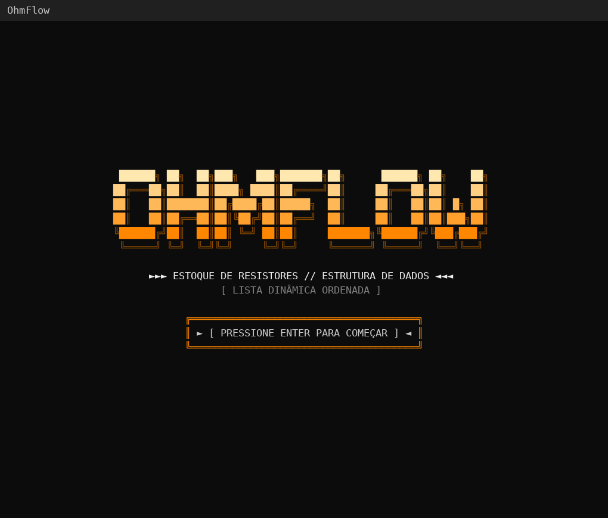
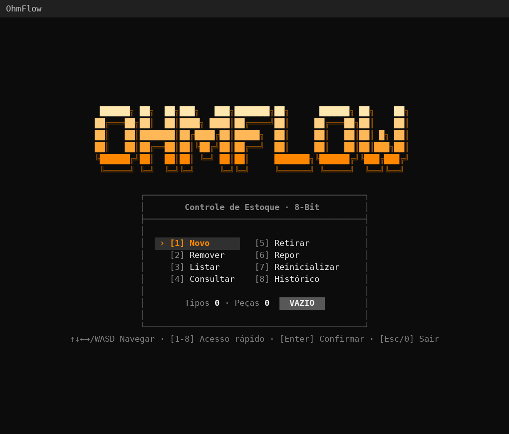
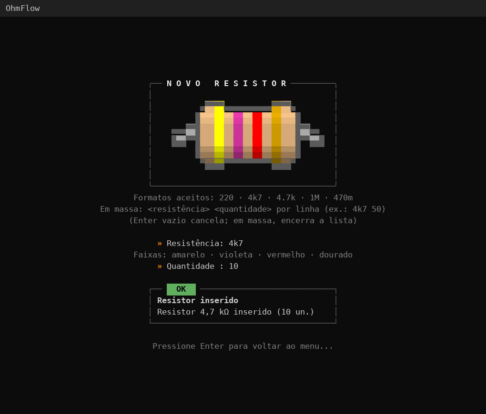
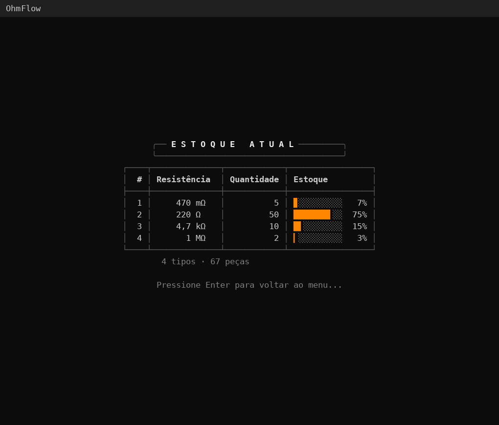
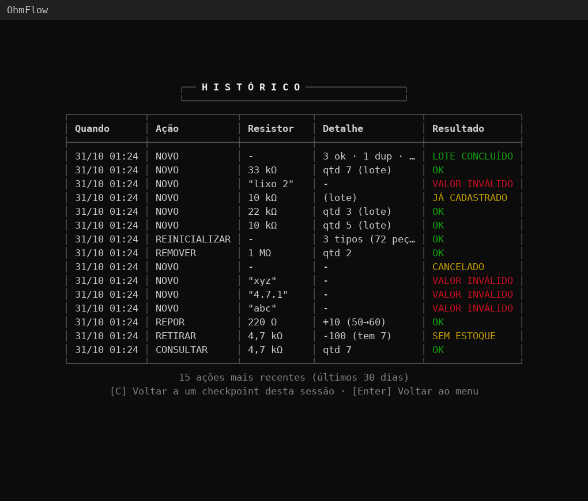
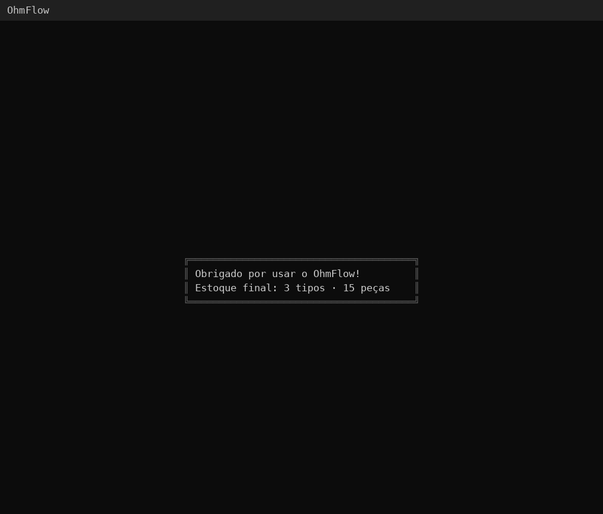

# OhmFlow

**Controle de estoque de resistores para o almoxarifado do laboratório — direto no terminal.**

[**⬇️ Baixar**](https://github.com/Grolla05/OhmFlow/releases) · [**📖 Documentação**](docs/README.md) · [**🧭 Guia do usuário**](docs/02-guia-do-usuario.md)

---

## 👋 Bem-vindo

O **OhmFlow** guarda quantos resistores de cada valor existem no laboratório: cadastre, consulte, retire, reponha e acompanhe o histórico, com tudo sempre em ordem crescente de resistência. Por trás da interface está uma **lista dinâmica ordenada** em C, o tema do Projeto 01 da disciplina *Estrutura de Dados e Recuperação da Informação* (PUC-Campinas).

## 📸 Telas

| Boas-vindas | Menu principal |
| :---: | :---: |
|  |  |
| **Novo (resistor colorido)** | **Estoque atual** |
|  |  |
| **Histórico e checkpoint** | **Encerramento** |
|  |  |

> Todos os prints estão em [docs/prints/](docs/prints/).

## ✨ Destaques

- Cadastro um a um ou em massa, com `4k7`, `470m`, `1M5` e outros formatos de bancada
- Tabela por ordem de grandeza (mΩ, Ω, kΩ, MΩ) e totais sempre visíveis
- Resistor desenhado com o **código de cores** do valor digitado
- **Desfazer/refazer** qualquer ação da sessão e registro de tudo em log
- Instalador para Windows, sem precisar de compilador

## 🚀 Começar

**Usar:** baixe o `ohm_flow_setup.exe` em [Releases](https://github.com/Grolla05/OhmFlow/releases) e instale.

**Compilar:** com MSYS2 (gcc + make + sqlite3) configurado, rode `make` e depois `.\dist\ohmflow.exe`. O passo a passo está em [docs/05-build-e-ambiente.md](docs/05-build-e-ambiente.md).

## 📚 Documentação

Toda a parte técnica está em [**docs/**](docs/README.md), escrita para qualquer leitor: [visão geral](docs/01-visao-geral.md), [funcionalidades](docs/funcionalidades/README.md), [arquitetura](docs/04-arquitetura.md), [módulos do código](docs/modulos/README.md), [testes](docs/06-testes.md) e [como contribuir](docs/09-contribuindo.md).

## 👥 Equipe

| [ **Felipe Grolla Freitas**](https://github.com/Grolla05) | [ **Guilherme Oliveira Nogueira**](https://github.com/Nogzzin) | [ **Giovanna Lima Salvagnini**](https://github.com/gisalvagnini) | [ **Henrique Spadaccia Chambó**](https://github.com/0chambo) |
| :---: | :---: | :---: | :---: |

Feito para a disciplina de Estrutura de Dados e Recuperação da Informação · PUC-Campinas · [Licença MIT](LICENSE)

