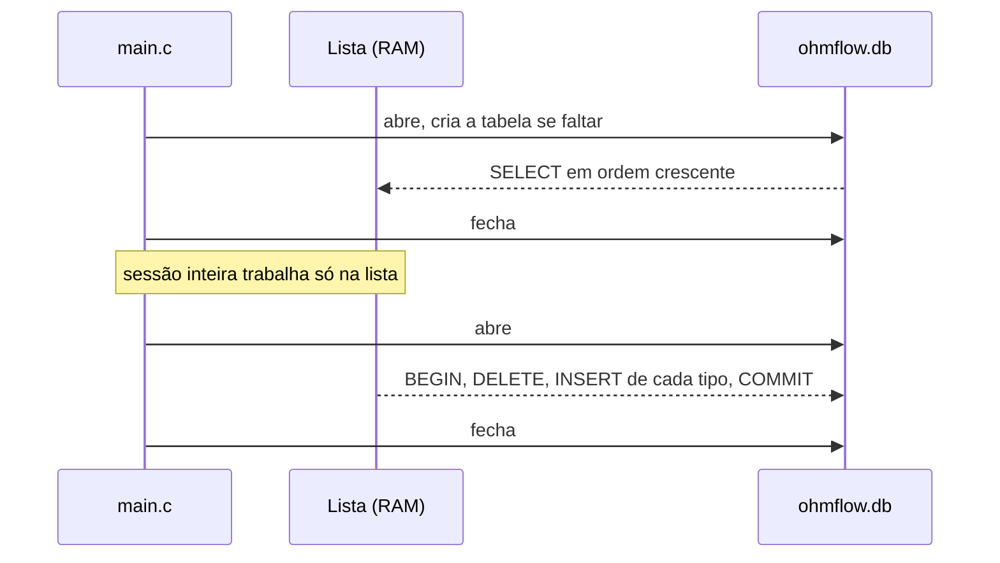

# Banco de dados do OhmFlow

Guarda o estoque de resistores entre uma execução e outra do programa. Sem ele, a lista dinâmica existe só na memória RAM e tudo se perde ao fechar.

## Conteúdo da pasta

| Arquivo | Versionado | Papel |
| --- | --- | --- |
| [database.sql](database.sql) | Sim | Schema: cria a tabela `resistores` |
| `ohmflow.db` | Não (`.gitignore`) | Banco gerado ao rodar o programa em desenvolvimento |

O `database.sql` é a única definição do schema. Na compilação, o Makefile o transforma em `build/schema_sql.h` e [src/persistencia.c](../src/persistencia.c) embute esse texto, então o executável instalado não precisa do arquivo `.sql`.

## Por que o banco existe

O enunciado pede uma lista dinâmica e não exige arquivos, mas um controle de almoxarifado que esquece o estoque ao fechar não serve para uso real. A persistência é parte do item diferencial do grupo.

A lista continua sendo a estrutura de trabalho: todas as operações acontecem nela. O banco é só onde o estoque descansa enquanto o programa está fechado.

## Como foi elaborado

**Motor: SQLite.** É um banco embutido, sem servidor, que grava em um único arquivo. Quem instala o OhmFlow não precisa instalar nem configurar nada. A biblioteca é ligada de forma estática, então o executável não ganha nenhuma DLL extra.

**Uma única tabela:**

```sql
CREATE TABLE IF NOT EXISTS resistores (
    resistencia REAL    PRIMARY KEY NOT NULL CHECK (resistencia > 0),
    quantidade  INTEGER NOT NULL CHECK (quantidade BETWEEN 0 AND 2147483647)
);
```

| Coluna | Tipo | Significado |
| --- | --- | --- |
| `resistencia` | `REAL` | Valor em Ω, a mesma chave da lista. Sendo chave primária, não há tipos repetidos |
| `quantidade` | `INTEGER` | Peças disponíveis. O limite é o de um `int` em C |

Cadastro, retirada e reposição aparecem como o estado resultante nessa tabela: uma retirada de 3 peças vira `quantidade` com 3 a menos. O histórico de cada movimento fica nos [logs](../docs/funcionalidades/11-registro-de-acoes.md), não no banco.

## Quando o banco é acessado

Apenas duas vezes por execução, e a conexão é aberta e fechada em cada uma:



Assim nenhuma tecla do menu espera por disco. Salvar uma foto completa dentro de uma transação evita rastrear o que mudou e cobre remoções e o Reinicializar: se algo falhar no meio, o banco continua como estava.

## Onde fica o arquivo

Na ordem de prioridade:

| Situação | Caminho |
| --- | --- |
| Variável `OHMFLOW_DB` definida (usada nos testes) | O caminho informado |
| Programa instalado | `%APPDATA%\OhmFlow\ohmflow.db` |
| Desenvolvimento (`make run`) | `database\ohmflow.db`, relativo à pasta atual |

Para consultar o banco manualmente:

```bash
sqlite3 database/ohmflow.db "SELECT * FROM resistores;"
```

## Comportamento em falhas e limitações

- **Banco ilegível ou corrompido:** o programa avisa, abre com o estoque vazio e **não salva ao sair**, para o arquivo original continuar disponível para recuperação.
- **Falha ao salvar:** aparece uma mensagem de erro e a ação `BANCO` fica registrada no log. O banco mantém a versão anterior.
- **Só salva ao sair pelo menu (`Esc` ou `0`):** `Ctrl+C`, fechar a janela ou queda de energia perdem as mudanças da sessão.
- **Duas instâncias ao mesmo tempo:** a última a sair sobrescreve a outra.
- **Desfazer não atravessa sessões:** o checkpoint começa vazio a cada abertura, com o estoque carregado como ponto 0.

Mais detalhes no módulo [Persistência](../docs/modulos/persistencia.md).
