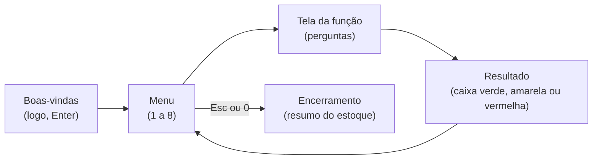

# 01 — Visão geral

← [Índice](README.md) · Próximo: [02 — Guia do usuário](02-guia-do-usuario.md)

> **Em uma frase:** o OhmFlow é um programa de terminal, escrito em linguagem C, que guarda quantos resistores de cada valor existem no almoxarifado de um laboratório e permite cadastrar, consultar, retirar, repor e remover esses resistores, sempre em ordem crescente de valor.

---

## 1. O problema

Um laboratório de eletrônica tem gavetas com **resistores**: pequenos componentes que dificultam a passagem da corrente elétrica. Cada resistor tem um valor, medido em **ohms (Ω)**, e os valores vão de frações de ohm (miliohms, mΩ) até milhões de ohms (megaohms, MΩ). Um almoxarifado comum guarda dezenas de valores diferentes, cada um com sua quantidade.

Sem um controle, as perguntas do dia a dia ficam difíceis:

- "Temos resistor de 4,7 kΩ? Quantos?"
- "Quero retirar 20 de 220 Ω para a aula: tem o suficiente?"
- "Chegou uma caixa de 10 kΩ: onde eu anoto?"
- "Qual era o estoque antes de alguém apagar tudo sem querer?"

O OhmFlow responde a essas perguntas.

## 2. O objetivo acadêmico

O OhmFlow é o **Projeto 01** da disciplina **Estrutura de Dados e Recuperação da Informação** (PUC-Campinas), feito em grupo. O foco da disciplina não é a eletrônica, e sim **como organizar dados na memória do computador**. Por isso o enunciado ([refs/Aula_07_Projeto01_22_10_2026.pdf](../refs/Aula_07_Projeto01_22_10_2026.pdf)) exige uma estrutura específica: a **Lista Dinâmica Ordenada**, adaptada da Lista Dinâmica Desordenada vista em aula.

"Lista dinâmica ordenada" quer dizer, em palavras simples:

- **Lista**: os resistores ficam um atrás do outro, como vagões de um trem.
- **Dinâmica**: cada vagão é criado na hora em que é necessário e destruído quando não serve mais; a lista não tem tamanho fixo.
- **Ordenada**: os vagões ficam sempre em ordem crescente de resistência. Um novo vagão é encaixado já no lugar certo.

O módulo [03 — Conceitos fundamentais](03-conceitos-fundamentais.md) explica isso em detalhes, do zero.

## 3. Requisitos do enunciado

O enunciado pede que cada nó da lista tenha dois campos e que o menu principal dê acesso a um conjunto de funções. A Tabela 1 mostra cada requisito e onde ele é atendido.

**Tabela 1 — Requisitos da Parte 01 e como o OhmFlow os atende**

| Requisito | Como é atendido | Onde no código |
| --- | --- | --- |
| Lista dinâmica ordenada | Lista simplesmente encadeada, inserção já na posição certa | [modulos/lista.md](modulos/lista.md) |
| Campo **resistência** (chave de ordenação) | `double resistencia`, sempre em Ω | `Resistor` em [src/lista.h](../src/lista.h) |
| Campo **quantidade** | `int quantidade` | `Resistor` em [src/lista.h](../src/lista.h) |
| Impressão por ordem de grandeza (mΩ, Ω, kΩ, MΩ) | `formata_resistencia` escolhe a unidade | [modulos/formatacao.md](modulos/formatacao.md) |
| Menu na `main` com as funções | Menu navegável por setas e números | [modulos/telas.md](modulos/telas.md), [modulos/main.md](modulos/main.md) |
| 1 — Novo | Cadastra um tipo, um a um ou em massa | `tela_inserir` |
| 2 — Remover | Apaga o tipo da lista, com confirmação | `tela_remover` |
| 3 — Listar | Tabela de todos os tipos e quantidades | `tela_listar` |
| 4 — Consultar | Quantidade disponível de uma resistência | `tela_consultar` |
| 5 — Retirar | Baixa de uma quantidade | `tela_retirar` |
| 6 — Repor | Soma de uma quantidade | `tela_repor` |
| 7 — Inicializar/Reinicializar | Esvazia a lista | `tela_reinicializar` |
| Item diferencial | Persistência em SQLite, checkpoint e busca binária | `[8] Histórico`, `persistencia.c` |
| Sair liberando a memória | `Esc` ou `0` no menu | `tela_encerramento` + `libera_lista` |

Além do que foi pedido, o projeto tem a opção **8 — Histórico**, que mostra as últimas ações registradas em arquivo e permite **voltar o estoque a qualquer ponto da sessão** (desfazer/refazer). Ela usa uma segunda estrutura de dados, a **pilha**, e é explicada em [modulos/checkpoint.md](modulos/checkpoint.md).

A **Parte 02** do trabalho (relatório e slides) pede: todas as estruturas usadas, código comentado e explicado, prints de cada teste e o link do repositório. Esta documentação serve de base para essa entrega.

## 4. O que o programa faz, em uma figura

A Figura 1 mostra a jornada de quem usa o programa: uma tela de boas-vindas, o menu, a tela da função escolhida, uma caixa de resultado e a volta ao menu, até sair.

**Figura 1 — Roteiro de telas do OhmFlow**

## 5. Características principais

| Característica | O que significa na prática |
| --- | --- |
| **Entrada flexível** | Aceita `4k7`, `4.7k`, `4,7k`, `4700`, `470m`, `1M5`, `4R7`, `220 ohm`... e todos viram o mesmo número em Ω |
| **Saída legível** | Imprime `4,7 kΩ` em vez de `4700.000000` |
| **Sempre ordenado** | A listagem já sai do menor para o maior valor, sem ordenar depois |
| **Totais instantâneos** | Número de tipos e de peças aparecem no menu sem recontar a lista |
| **Inserção em massa** | Vários resistores de uma vez, um por linha |
| **Resistor colorido** | Na tela Novo, desenha o resistor com as faixas do código de cores do valor digitado |
| **Estoque persistente** | O estoque é salvo em SQLite ao sair e volta na próxima abertura |
| **Busca binária** | Encontra qualquer resistor em poucos passos, mesmo com milhares de tipos |
| **Tela cheia** | O programa abre ocupando a tela inteira |
| **Desfazer/refazer** | Volta o estoque a qualquer ponto da sessão atual e avança de novo |
| **Registro de ações (log)** | Cada ação vira uma linha num arquivo de texto do dia |
| **Interface de terminal caprichada** | Cores, molduras, tabelas alinhadas, menu por setas, telas centralizadas |
| **Instalador para Windows** | `ohm_flow_setup.exe`, sem precisar de compilador |
| **Testado automaticamente** | Testes unitários, ponta a ponta e do instalador rodam a cada envio ao GitHub |

## 6. O que o programa **não** faz (limites conhecidos)

- **Não salva durante a sessão.** O estoque vai para o banco ao sair pelo menu; `Ctrl+C`, fechar a janela ou queda de energia perdem o que foi feito naquela execução. Ver [database/README.md](../database/README.md).
- **Não roda oficialmente em Linux ou macOS.** O código tem trechos para esses sistemas, mas só o Windows 10/11 é suportado e testado.
- **Não tem interface gráfica.** É um programa de terminal (janela de texto).
- **Não controla quem retirou o quê.** Não há usuários nem senhas.

## 7. Equipe

| Integrante | GitHub |
| --- | --- |
| Felipe Grolla Freitas | [@Grolla05](https://github.com/Grolla05) |
| Guilherme Oliveira Nogueira | [@Nogzzin](https://github.com/Nogzzin) |
| Giovanna Lima Salvagnini | @gisalvagnini |
| Henrique Spadaccia Chambó | [@0chambo](https://github.com/0chambo) |

Fonte: [CODEOWNERS](../CODEOWNERS). Licença: MIT ([LICENSE](../LICENSE)).

## 8. Tecnologias em uma tabela

| Tecnologia | Para quê | Por que esta |
| --- | --- | --- |
| **C99** | Linguagem do programa | Exigida pela disciplina; dá controle direto da memória |
| **gcc (MSYS2 UCRT64)** | Compilador | Gratuito, padrão no Windows para C, gera um `.exe` sem dependências extras |
| **make** | Automatiza compilar e testar | Um comando por tarefa (`make`, `make test`...) |
| **cppcheck** | Procura erros no código sem rodá-lo | Pega problemas que o compilador não vê |
| **Inno Setup 6** | Gera o instalador | Gratuito, maduro, em português |
| **GitHub Actions** | Roda tudo automaticamente na nuvem | Garante que nada quebrado entre no repositório |
| **Mermaid** | Diagramas desta documentação | O GitHub desenha a partir de texto |

---

← [Índice](README.md) · Próximo: [02 — Guia do usuário](02-guia-do-usuario.md)
