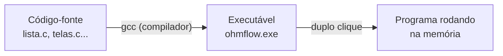
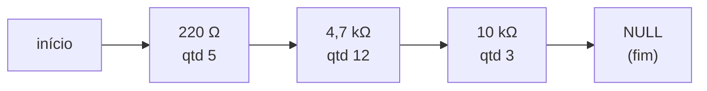
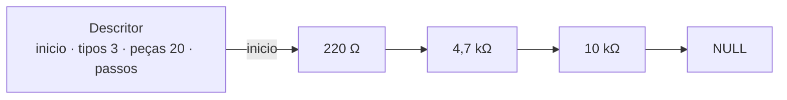
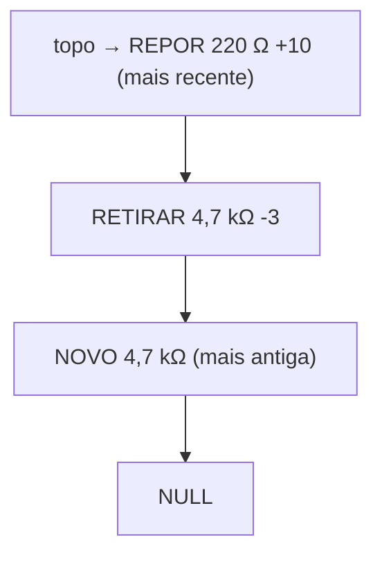

# 03 — Conceitos fundamentais

← Anterior: [02 — Guia do usuário](02-guia-do-usuario.md) · [Índice](README.md) · Próximo: [04 — Arquitetura](04-arquitetura.md)

> Este módulo explica, **sem supor conhecimento prévio**, as ideias de programação que o OhmFlow usa. Quem já programa em C pode pular para [04 — Arquitetura](04-arquitetura.md). Cada seção termina com "No OhmFlow", ligando a ideia ao código real.

---

## 1. Programa, código-fonte e compilação

Um **programa** é uma lista de instruções para o computador. Pessoas escrevem essas instruções numa **linguagem de programação** (aqui, a linguagem **C**), em arquivos de texto chamados **código-fonte** (`.c` e `.h`).

O computador não entende C diretamente. Um **compilador** (o `gcc`) traduz o código-fonte para linguagem de máquina e gera um **executável** (`ohmflow.exe`), que é o arquivo que você abre.



**Figura 1 — Do texto ao programa**

Arquivos `.h` (**cabeçalhos**) são a "vitrine" de um módulo: dizem *o que* ele oferece. Arquivos `.c` são a "cozinha": dizem *como* é feito.

**No OhmFlow:** `lista.h` anuncia funções como `insere_lista_ordenada`; `lista.c` contém o passo a passo de cada uma.

## 2. Memória, variáveis e tipos

A **memória RAM** é como um armário enorme de gavetas numeradas. Cada gaveta tem um **endereço** (um número) e guarda um pouco de informação. Uma **variável** é um nome que damos a uma gaveta, para não precisar decorar o número.

Cada variável tem um **tipo**, que diz o que cabe nela:

| Tipo em C | Guarda | Exemplo no OhmFlow |
| --- | --- | --- |
| `int` | Número inteiro (até ~2,1 bilhões) | `quantidade` de um resistor |
| `long long` | Inteiro muito grande | `pecas`, o total de peças do estoque |
| `double` | Número com casas decimais | `resistencia` em Ω (ex.: `0.47`, `4700.0`) |
| `char[]` | Texto | O que o usuário digitou, como `"4k7"` |

**No OhmFlow:** o total de peças é `long long` porque, no Windows, `long` tem só 32 bits; somar muitas quantidades `int` poderia estourar.

## 3. Struct: juntando informações

Um **struct** agrupa várias variáveis em uma só "ficha". Em vez de duas variáveis soltas, o resistor vira uma ficha com dois campos:

```c
typedef struct {
    double resistencia; /* valor em Ω (chave de ordenação) */
    int    quantidade;  /* unidades disponíveis no estoque */
} Resistor;
```

**No OhmFlow:** `Resistor` (em [src/lista.h](../src/lista.h)) é exatamente essa ficha. `Operacao` (em [src/pilha.h](../src/pilha.h)) é outra, que descreve uma ação feita no estoque.

## 4. Ponteiros: o endereço de uma gaveta

Um **ponteiro** é uma variável que guarda **o endereço de outra gaveta**, e não um valor comum. É como um papel com "gaveta 1.024" escrito: com ele, você vai até lá e lê ou muda o conteúdo.

- `Elem *no` — "`no` guarda o endereço de um elemento".
- `no->dados` — "vá até o elemento apontado por `no` e pegue o campo `dados`".
- `NULL` — um endereço especial que significa "não aponta para nada" (o fim da fila).

**Ponteiro para ponteiro** (`Elem **`) é um papel com o endereço de *outro papel*. No OhmFlow, `Elem **indice` é um vetor de endereços de nós, a peça que permite a busca binária. Ver [modulos/lista.md](modulos/lista.md#3-o-coração-localiza).

## 5. Memória dinâmica: `malloc` e `free`

Quando o programa não sabe de antemão quantas fichas vai precisar, ele pede gavetas **durante a execução**:

- `malloc(tamanho)` — "me dê uma gaveta deste tamanho"; devolve o endereço dela (ou `NULL` se a memória acabou).
- `free(endereco)` — "devolvo esta gaveta, não preciso mais".

Toda gaveta pedida com `malloc` **precisa** ser devolvida com `free`. Esquecer é um **vazamento de memória** (*memory leak*): o programa vai acumulando gavetas que ninguém usa.

**No OhmFlow:** cada resistor cadastrado é um `malloc`; remover, reinicializar ou sair faz o `free` correspondente. A regra do projeto é "cada `malloc` com o seu `free`", conferida pelos testes.

## 6. Lista encadeada

Uma **lista encadeada** guarda elementos espalhados pela memória, cada um com o endereço do próximo. É um **trem**: cada vagão (nó) leva sua carga (um `Resistor`) e um engate (o ponteiro `prox`) para o vagão seguinte. O último vagão tem o engate solto (`NULL`).



**Figura 2 — Lista encadeada com três resistores**

Comparação com um **vetor** (array), que é uma fileira de gavetas *contíguas* de tamanho fixo:

| Pergunta | Vetor | Lista encadeada |
| --- | --- | --- |
| Tamanho | Fixo (ou precisa realocar tudo para crescer) | Cresce e encolhe nó a nó |
| Inserir no meio | Empurra todos os seguintes uma posição | Troca dois engates |
| Acessar o 50º elemento | Direto (instantâneo) | Precisa percorrer 49 nós |
| Memória extra | Nenhuma | Um ponteiro por nó |

**Lista ordenada** é uma lista em que cada vagão novo é **encaixado na posição certa**, de modo que o trem esteja sempre em ordem crescente. Vantagem extra: ao procurar um valor, dá para **parar cedo** assim que se passa dele.

**No OhmFlow:** a estrutura central é exatamente esta. Detalhes em [modulos/lista.md](modulos/lista.md).

## 7. Nó descritor

O **nó descritor** é uma ficha à parte que fica "na frente do trem" e guarda informações sobre a lista inteira: onde ela começa e os totais. Assim, perguntas como "quantos tipos?" são respondidas lendo um campo, sem contar vagão por vagão.



**Figura 3 — O descritor aponta para o primeiro nó e guarda os totais**

## 8. Pilha (LIFO)

Uma **pilha** é como uma pilha de pratos: só se coloca (**empilhar**) e só se tira (**desempilhar**) pelo **topo**. O último a entrar é o primeiro a sair: em inglês, *Last In, First Out* (**LIFO**).



**Figura 4 — Pilha de ações; a mais recente fica no topo**

Pilhas são perfeitas para **desfazer**: a última coisa feita é a primeira a ser desfeita.

**No OhmFlow:** [modulos/pilha.md](modulos/pilha.md) implementa a pilha, e [modulos/checkpoint.md](modulos/checkpoint.md) usa **duas** pilhas (desfazer e refazer).

## 9. TAD — Tipo Abstrato de Dados

Um **TAD** é uma estrutura de dados acompanhada das únicas operações permitidas sobre ela, **escondendo os detalhes internos**. Quem usa sabe *o que* pode fazer, mas não *como* está guardado.

Analogia: o motorista usa volante, pedais e câmbio. Não precisa (nem deve) mexer direto no motor.

Em C, isso se faz com um **tipo opaco**: o `.h` diz apenas que o tipo existe (`typedef struct descritor Lista;`), e só o `.c` sabe o que há dentro. O resto do programa não consegue acessar os campos diretamente, só pelas funções.

**No OhmFlow:** `Lista`, `Pilha` e `Checkpoint` são opacos. As telas nunca mexem em `inicio` ou `prox`; só chamam `insere_lista_ordenada`, `remove_lista` etc. Isso impede, por exemplo, que alguém desordene a lista sem querer.

## 10. Códigos de retorno

Em C não há "exceções" como em outras linguagens. Cada função **devolve um número** que indica o que aconteceu, e quem chamou decide o que mostrar.

| Código (lista) | Valor | Significado |
| --- | --- | --- |
| `LISTA_OK` | 1 | Deu certo |
| `LISTA_ERRO` | 0 | Lista inexistente ou memória acabou |
| `LISTA_NAO_ENCONTRADO` | -1 | Resistência não cadastrada |
| `LISTA_DUPLICADO` | -2 | Resistência já cadastrada |
| `LISTA_SEM_ESTOQUE` | -3 | Retirada maior que o disponível |
| `LISTA_INVALIDO` | -4 | Valor ou quantidade fora do permitido |

**No OhmFlow:** a lista **nunca imprime nada**; ela só devolve o código. A tela transforma `LISTA_SEM_ESTOQUE` em "Estoque insuficiente". Essa separação é discutida em [04 — Arquitetura](04-arquitetura.md).

## 11. Complexidade: quanto trabalho cada operação dá

A notação **O(...)** ("ó grande") descreve como o trabalho cresce quando os dados crescem. Com *n* tipos de resistor:

| Notação | Leitura | Exemplo no OhmFlow |
| --- | --- | --- |
| **O(1)** | Trabalho constante, não importa o tamanho | Saber o total de peças (lê o descritor); empilhar uma ação |
| **O(log n)** | Dobrar os dados custa só um passo a mais | Procurar um resistor (busca binária) |
| **O(n)** | Trabalho proporcional ao tamanho | Listar; abrir ou fechar uma posição no vetor ao inserir ou remover |

A ordenação é o que permite a **busca binária**: olhando o termo do meio, sabe-se que à esquerda as resistências diminuem e à direita aumentam, e metade dos candidatos é descartada a cada passo. Com 1.000 tipos, são no máximo 10 passos em vez de até 1.000. Como nó encadeado não tem acesso direto ao meio, a lista mantém um vetor de ponteiros para os nós. O programa conta esses passos em `lista_passos`.

## 12. Números com vírgula no computador (ponto flutuante)

Computadores guardam números decimais em **binário**, e muitos valores "redondos" para nós não são exatos para eles. O caso clássico: **0,001 não tem representação exata em binário**. Por isso `470 × 0,001` pode dar um número minimamente diferente de `0,47`.

Isso importa porque a resistência é a **chave** da lista: se `470m` e `0.47` virassem números diferentes, o mesmo resistor seria cadastrado duas vezes. O OhmFlow resolve de dois jeitos:

1. **Converte o texto de uma vez só** (`470m` vira o texto `"470.0e-3"`, lido por `strtod`), o que dá o mesmo número para todas as grafias. Ver [modulos/formatacao.md](modulos/formatacao.md).
2. **Compara com tolerância** (`mesma_resistencia`): dois valores são iguais se a diferença for menor que um bilionésimo do maior deles. Ver [modulos/lista.md](modulos/lista.md).

## 13. Terminal, cores e "modo interativo"

O **terminal** (ou console) é a janela de texto onde o programa roda. Cores, molduras e limpeza de tela são feitas com **códigos ANSI**: sequências invisíveis como `\033[32m` ("a partir daqui, verde").

O programa também pode rodar **sem pessoa nenhuma**: com o teclado substituído por um arquivo de texto e a tela por outro arquivo. Isso se chama **entrada/saída redirecionada** e é como os testes automáticos funcionam. Nesse caso o programa entra em **modo não interativo**: sem cores, sem limpar tela, sem esperar Enter, e repetindo na saída o que "foi digitado". Ver [modulos/ui.md](modulos/ui.md).

## 14. Testes automatizados

Um **teste automatizado** é um pequeno programa que usa o programa principal e confere se o resultado é o esperado, por exemplo "depois de inserir 220 Ω, a lista tem 1 tipo". Rodar centenas de conferências leva segundos, e qualquer alteração que quebre algo é descoberta na hora. Ver [06 — Testes](06-testes.md).

---

← Anterior: [02 — Guia do usuário](02-guia-do-usuario.md) · [Índice](README.md) · Próximo: [04 — Arquitetura](04-arquitetura.md)
