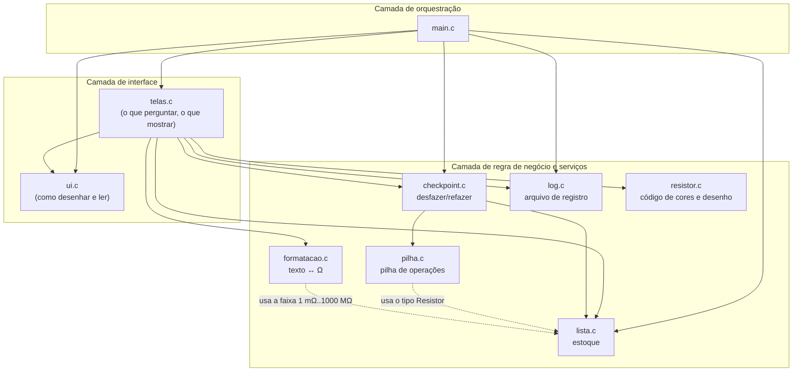
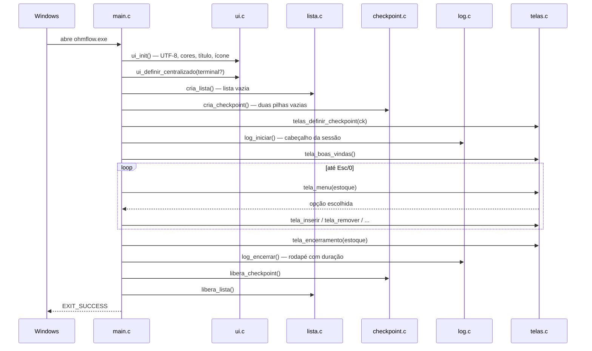
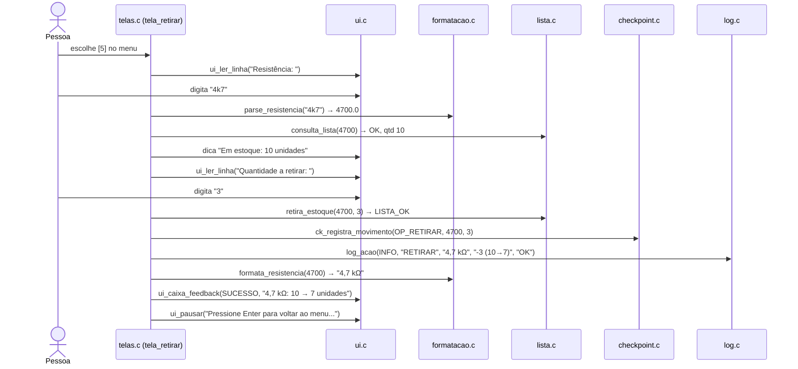

# 04 — Arquitetura

← Anterior: [03 — Conceitos fundamentais](03-conceitos-fundamentais.md) · [Índice](README.md) · Próximo: [Módulos do código-fonte](modulos/README.md)

> **Princípio central:** a **regra de negócio** (o que é um estoque válido e como ele muda) fica separada da **interação com o usuário** (perguntar, mostrar, colorir). `lista`, `pilha`, `checkpoint` e `formatacao` não imprimem nada; `ui` e `telas` não mexem na estrutura da lista por dentro. O `main.c` só amarra as peças.

---

## 1. Árvore do repositório

```text
OhmFlow/
├── src/                          código-fonte do programa
│   ├── lista.h / lista.c         TAD lista dinâmica ordenada (chave: resistência)
│   ├── pilha.h / pilha.c         TAD pilha dinâmica de operações (LIFO)
│   ├── checkpoint.h / .c         desfazer/refazer com duas pilhas
│   ├── formatacao.h / .c         texto "4k7" <-> 4700 Ω <-> "4,7 kΩ"
│   ├── resistor.h / .c           código de cores de 4 faixas e desenho do resistor
│   ├── log.h / log.c             registro das ações em arquivo
│   ├── persistencia.h / .c       carga e salvamento do estoque em SQLite
│   ├── main.c                    ponto de entrada: monta, roda e desmonta
│   ├── ui/
│   │   ├── ui.h / ui.c           primitivas de terminal (cores, caixas, tabelas, entrada)
│   │   └── telas.h / telas.c     telas do programa e menu
│   └── assets/
│       ├── ohmflow.rc            recursos do .exe (ícone e versão)
│       ├── ressistor_preencher.* forma de referência do desenho do resistor (.svg/.png)
│       └── logo/                 logo.png e ohmflow.ico
├── tests/                        testes automatizados
│   ├── test_framework.h          mini framework de testes
│   ├── test_*.c                  uma suíte por módulo
│   ├── e2e/                      entrada.txt (roteiro) + esperado.txt
│   └── setup/test_setup.ps1      teste do instalador
├── installer/ohmflow.iss         script do instalador (Inno Setup 6)
├── .github/                      CI, modelos de issue/PR, guias
├── refs/                         enunciado e brainstorm
├── docs/                         esta documentação
├── Makefile                      receitas de build e teste
├── README.md, LICENSE, CODEOWNERS
├── build/  (gerada)              objetos, testes compilados, saída do e2e
└── dist/   (gerada)              ohmflow.exe e ohm_flow_setup.exe
```

As pastas `build/` e `dist/` são criadas pelo `make` e ignoradas pelo Git (ver `.gitignore`). A pasta `logs/` aparece quando o programa roda em modo de desenvolvimento e também é ignorada.

## 2. Camadas

A Figura 1 mostra o programa em três camadas. Cada camada só usa as de baixo.



**Figura 1 — Camadas e dependências (seta = "usa")**

A Tabela 1 resume o que cada módulo sabe e o que ele **não** sabe.

**Tabela 1 — Responsabilidades e fronteiras**

| Módulo | Responsável por | Não sabe nada de |
| --- | --- | --- |
| `lista` | Guardar resistores em ordem, manter totais, validar faixa | Telas, texto, cores, arquivos |
| `pilha` | Empilhar/desempilhar operações e cuidar da memória delas | Como uma operação é desfeita |
| `checkpoint` | Desfazer/refazer usando só a API pública da lista | Telas e log |
| `formatacao` | Converter texto ↔ número e escolher a unidade | Lista encadeada, telas |
| `log` | Escrever e ler o arquivo de registro | Lista, telas, cores |
| `resistor` | Calcular as 4 faixas de cor de um valor e desenhar o resistor | Lista, telas, entrada do usuário |
| `ui` | Desenhar caixas, tabelas e mensagens; ler linhas e teclas | Resistores, estoque |
| `telas` | Conduzir cada tela, chamar a regra de negócio, mostrar o resultado e registrar no log | Como a lista é encadeada por dentro |
| `main` | Criar, ligar e destruir tudo; rodar o laço do menu | Detalhes de qualquer tela |

Por que isso importa (detalhes em [08 — Decisões de projeto](08-decisoes-de-projeto.md)):

- **Testabilidade:** a lista é testada sem abrir nenhuma tela; as telas são testadas mandando a saída para um arquivo.
- **Trocar a interface sem tocar no estoque:** uma interface gráfica futura reaproveitaria `lista`, `checkpoint` e `formatacao` sem mudança.
- **Relatório da disciplina:** a estrutura de dados fica isolada e fácil de explicar.

## 3. Ciclo de vida do programa

A Figura 2 mostra o que acontece do momento em que o `.exe` é aberto até ele fechar. O código correspondente está em [src/main.c](../src/main.c), explicado em [modulos/main.md](modulos/main.md).



**Figura 2 — Ciclo de vida de uma execução**

## 4. O caminho de uma ação: "Retirar 3 unidades de 4,7 kΩ"

Para ver as camadas trabalhando juntas, a Figura 3 segue uma retirada do teclado até a memória e de volta.



**Figura 3 — Uma retirada atravessando as camadas**

Observações:

1. A tela **consulta antes** para mostrar o estoque atual e dar uma mensagem melhor se o resistor não existir.
2. O registro no **checkpoint** acontece **só se a lista respondeu `LISTA_OK`**. Assim, a pilha de desfazer nunca guarda uma ação que não aconteceu.
3. O **log** recebe uma linha seja qual for o resultado (sucesso, falta de estoque, cancelamento ou valor inválido).

## 5. Estruturas de dados do projeto

A Tabela 2 lista todas as estruturas de dados, item exigido no relatório da Parte 02.

**Tabela 2 — Estruturas de dados usadas**

| Estrutura | Onde | Tipo | Para quê |
| --- | --- | --- | --- |
| **Lista dinâmica ordenada** com nó descritor | `lista.c` | Lista simplesmente encadeada | O estoque (estrutura central exigida) |
| **Pilha dinâmica** com nó descritor | `pilha.c` | Pilha encadeada (LIFO) | Ações aplicadas e desfeitas |
| **Duas pilhas** (desfazer + refazer) | `checkpoint.c` | Composição de pilhas | Linha do tempo navegável da sessão |
| **Vetor dinâmico** que dobra de tamanho | `telas.c` (`Lote`) | Array com `realloc` | Juntar os itens de uma inserção em massa |
| **Vetor "foto"** do estoque | `checkpoint.c` (`Foto`) | Array alocado no tamanho exato | Guardar o estoque antes de Reinicializar |
| **Buffer circular** | `log.c` (`log_ultimas`) | Array de tamanho fixo com índice módulo *max* | Guardar só as 15 ações mais recentes lidas dos arquivos |
| **Struct `Operacao`** | `pilha.h` | Registro | Descrever uma ação e o necessário para invertê-la |
| **Struct `LogEntrada`** | `log.h` | Registro | Uma linha do log lida de volta, campo a campo |
| **Matriz de pixels** (`MAPA`, 12 × 32) | `resistor.c` | Vetor de strings constantes | Forma do resistor desenhado; cada caractere é um tipo de pixel |
| **Tabelas de consulta** (`PALETA`, `NOMES`, `SOMBRA`) | `resistor.c` | Vetores indexados pela cor/linha | Cor RGB, nome e sombreamento de cada faixa |

## 6. Interfaces entre módulos (resumo)

A Tabela 3 mostra as funções públicas mais usadas. A referência completa de cada uma está no módulo correspondente.

**Tabela 3 — Principais funções públicas**

| Módulo | Funções |
| --- | --- |
| [lista](modulos/lista.md) | `cria_lista`, `libera_lista`, `reinicializa_lista`, `insere_lista_ordenada`, `remove_lista`, `consulta_lista`, `retira_estoque`, `repor_estoque`, `percorre_lista`, `tamanho_lista`, `total_pecas`, `lista_vazia`, `lista_passos`, `mesma_resistencia` |
| [pilha](modulos/pilha.md) | `cria_pilha`, `libera_pilha`, `esvazia_pilha`, `empilha`, `desempilha`, `topo_pilha`, `percorre_pilha`, `tamanho_pilha`, `pilha_vazia`, `libera_operacao` |
| [checkpoint](modulos/checkpoint.md) | `cria_checkpoint`, `libera_checkpoint`, `ck_registra_*`, `ck_descarta`, `ck_desfazer`, `ck_refazer`, `ck_ir_para`, `ck_posicao`, `ck_total`, `ck_operacao` |
| [formatacao](modulos/formatacao.md) | `parse_resistencia`, `formata_resistencia`, `grandeza_resistencia` |
| [resistor](modulos/resistor.md) | `codigo_cores`, `nome_cor_faixa`, `resistor_rgb_faixa`, `resistor_arte` |
| [persistencia](modulos/persistencia.md) | `persistencia_caminho`, `persistencia_carregar`, `persistencia_salvar` |
| [log](modulos/log.md) | `log_iniciar`, `log_encerrar`, `log_acao`, `log_ultimas`, `log_parse_linha`, `log_formata_linha` |
| [ui](modulos/ui.md) | `ui_init`, `ui_caixa`, `ui_caixa_feedback`, `ui_mensagem`, `ui_dica`, `ui_ler_linha`, `ui_confirmar`, `ui_tabela_*` |
| [telas](modulos/telas.md) | `tela_*`, `navegar_menu`, `menu_tecla_opcao`, `decodifica_tecla`, `parse_item`, `checkpoint_navegar`, `telas_definir_checkpoint`, `telas_definir_resistor` |

## 7. Compilação condicional (o mesmo código, variações diferentes)

O código usa `#ifdef` para gerar variações sem duplicar arquivos. A Tabela 4 lista as chaves.

**Tabela 4 — Chaves de compilação**

| Chave | Quem define | Efeito |
| --- | --- | --- |
| `_WIN32` | O compilador, no Windows | Usa a API do console do Windows (`_getch`, `SetConsoleMode`, ícone...) em vez de `termios` |
| `OHM_ASCII` | `make EXTRA_CFLAGS=-DOHM_ASCII` | Troca `Ω`, `✔`, `╭─╮` por `ohm`, `[OK]`, `+-+` e desliga o desenho do resistor |
| `OHM_LOGS_APPDATA` | `make setup` | Grava os logs em `%APPDATA%\OhmFlow\logs` (o exe do instalador) |
| `OHM_DADOS_APPDATA` | `make setup` | Grava o banco em `%APPDATA%\OhmFlow\ohmflow.db` (o exe do instalador) |
| `_POSIX_C_SOURCE` | `ui.c`, `log.c`, `persistencia.c` (fora do Windows) | Libera `isatty`, `fileno` e `mkdir` com `-std=c99` |
| `VERSAO`, `VERSAO_NUM` | `Makefile` → `windres` | Versão gravada no `.exe` (Propriedades → Detalhes) |

Há também as variáveis de ambiente `NO_COLOR` (desliga cores na execução), `OHMFLOW_LOGS_DIR` (pasta dos logs na execução) e `OHMFLOW_DB` (arquivo do banco na execução).

---

← Anterior: [03 — Conceitos fundamentais](03-conceitos-fundamentais.md) · [Índice](README.md) · Próximo: [Módulos do código-fonte](modulos/README.md)
