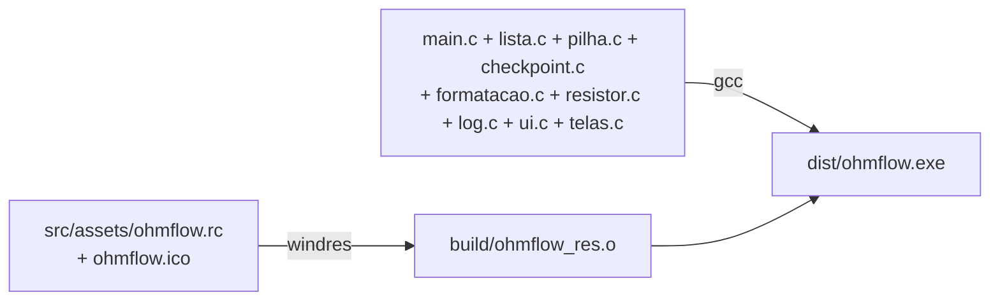

# 05 — Build e ambiente de desenvolvimento

← Anterior: [Funcionalidades](funcionalidades/README.md) · [Índice](README.md) · Próximo: [06 — Testes](06-testes.md)

> Este módulo é para quem vai **compilar** o OhmFlow a partir do código. Para só usar, veja o [Guia do usuário](02-guia-do-usuario.md). O projeto é suportado **somente no Windows 10/11**, e tudo aqui é feito pelo **PowerShell**.

---

## 1. "Compilar", "build" e "make" em uma frase cada

- **Compilar:** traduzir o código C para um executável (`gcc`).
- **Build:** o processo inteiro de gerar os produtos (executável, testes, instalador).
- **make:** ferramenta que lê o `Makefile` (uma "receita") e roda os comandos certos, na ordem certa, só refazendo o que mudou.

## 2. Ferramentas

**Tabela 1 — Ferramentas de desenvolvimento**

| Ferramenta | Para quê | Obrigatória? | Vem de |
| --- | --- | --- | --- |
| Git | Baixar o código e versionar | Sim (ou ZIP) | MSYS2 ou git-scm.com |
| gcc (UCRT64) | Compilar | Sim | MSYS2 |
| make | Rodar as receitas | Sim | MSYS2 |
| binutils (`windres`, `objdump`) | Embutir ícone/versão; checar subsistema | Sim (vem com o gcc) | MSYS2 |
| cppcheck | Análise estática | Não | MSYS2 |
| Inno Setup 6 | Gerar o instalador | Não | `winget install JRSoftware.InnoSetup` |
| Python + Pillow | Regenerar o ícone (`make icone`) | Não | python.org + `pip install pillow` |

**MSYS2** é um pacote que traz para o Windows o gerenciador de pacotes `pacman` e as ferramentas GNU. O ambiente **UCRT64** gera executáveis que usam a biblioteca C universal do Windows 10/11 (UCRT), sem DLLs extras.

## 3. Instalação passo a passo (PowerShell)

**1. MSYS2** (pasta padrão `C:\msys64`):

```powershell
winget install --id MSYS2.MSYS2 -e
```

**2. Atualizar** — rode **duas vezes** (a primeira atualiza o núcleo do `pacman`):

```powershell
C:\msys64\usr\bin\bash.exe -lc "pacman -Syu --noconfirm"
```

**3. Ferramentas:**

```powershell
C:\msys64\usr\bin\bash.exe -lc "pacman -S --needed --noconfirm git make mingw-w64-ucrt-x86_64-gcc mingw-w64-ucrt-x86_64-cppcheck mingw-w64-ucrt-x86_64-sqlite3"
```

**4. PATH** — acrescenta as pastas no **fim** do PATH do usuário (assim `find`, `sort` do Windows continuam valendo). Depois, **abra um PowerShell novo**:

```powershell
$atual = [Environment]::GetEnvironmentVariable('Path', 'User')
[Environment]::SetEnvironmentVariable('Path', "$atual;C:\msys64\ucrt64\bin;C:\msys64\usr\bin", 'User')
```

**5. Conferir:**

```powershell
gcc --version; make --version; git --version; cppcheck --version
```

**6. Baixar o projeto:**

```powershell
git clone https://github.com/Grolla05/OhmFlow.git
cd OhmFlow
```

## 4. Compilar e executar

```powershell
make                 # gera dist\ohmflow.exe
.\dist\ohmflow.exe   # executa (ou: make run)
make clean           # apaga build\ e dist\
```

Rode no **Windows Terminal, PowerShell ou cmd**. O terminal do MSYS2 (mintty) não é reconhecido como console interativo: nele o programa fica sem cores, sem limpar a tela e sem pausas.

## 5. O `Makefile`, alvo por alvo

### 5.1 Variáveis principais

| Variável | Valor | Significado |
| --- | --- | --- |
| `CC` | `gcc` | Compilador |
| `CFLAGS` | `-std=c99 -Wall -Wextra -pedantic -g -Isrc -Isrc/ui` | C99 estrito, todos os avisos, símbolos de depuração, pastas de cabeçalhos |
| `EXTRA_CFLAGS` | vazio | Gancho para `-Werror`, `-DOHM_ASCII`, sanitizers |
| `LDLIBS` | `-lm` | Biblioteca matemática (`fabs`, `floor`, `isnan`) |
| `VERSAO` | `1.0.0` | Versão do exe e do instalador |
| `VERSAO_NUM` | `1,0,0,0` | Derivada de `VERSAO` (formato do VERSIONINFO; sufixos como `-ci` são descartados) |

No Windows (`OS=Windows_NT`) também são definidos `EXE=.exe`, `WINDRES=windres`, o ícone, o objeto de recursos `build/ohmflow_res.o` e a checagem de subsistema console.

### 5.2 Alvos

**Tabela 2 — Alvos do Makefile**

| Comando | O que faz | Produz |
| --- | --- | --- |
| `make` / `make all` | Compila os recursos (`windres`) e o programa | `dist/ohmflow.exe` |
| `make run` | Compila se preciso e executa | — |
| `make test` | Compila e roda as 9 suítes de teste; falha se alguma falhar | `build/test_*.exe` |
| `make e2e` | Roda o exe com um roteiro e confere a saída e o log | `build/e2e_saida.txt`, `build/e2e_logs/` |
| `make asan` | Testes + e2e com AddressSanitizer/UBSan em `build/asan` (não funciona no MinGW; fora do CI) | — |
| `make cppcheck` | Análise estática de `src/` | — |
| `make icone` | Regenera `src/assets/logo/ohmflow.ico` a partir de `logo.png` (Python + Pillow) | `.ico` |
| `make setup [VERSAO=x.y.z]` | Compila o exe do instalador (com `-DOHM_LOGS_APPDATA`) e roda o Inno Setup | `dist/instalador/ohmflow.exe`, `dist/ohm_flow_setup.exe` |
| `make teste-setup` | Gera o setup e roda `tests/setup/test_setup.ps1` | — |
| `make clean` | Apaga `build/` e `dist/` | — |

### 5.3 Como o executável é montado



**Figura 1 — Do código ao executável**

Os **testes** são compilados com os mesmos arquivos da biblioteca (`SRC_LIB`, tudo menos `main.c`), cada um com o seu `main` de teste.

### 5.4 Detalhes que evitam dor de cabeça

| Detalhe | Por quê |
| --- | --- |
| O `.ico` é versionado e só é gerado se faltar | Um checkout limpo compila sem Python |
| `MSYS2_ARG_CONV_EXCL='*'` no `make setup` | Impede o MSYS de transformar `/Q` e `/DVersao=...` em caminhos |
| `make setup` procura o `ISCC.exe` no PATH, em `Program Files (x86)` e em `%LOCALAPPDATA%\Programs` | Funciona com instalação global ou por usuário (winget) |
| Ao trocar `VERSAO`, rode `make clean` | O recurso de versão só é recompilado se o `.rc` mudar |
| `.gitattributes`: `* text=auto eol=lf` | Makefile e scripts quebram com fim de linha CRLF |

## 6. Opções de compilação e execução

| Opção | Como | Efeito |
| --- | --- | --- |
| Avisos viram erros | `make EXTRA_CFLAGS=-Werror` | Usado no CI |
| Só ASCII | `make EXTRA_CFLAGS=-DOHM_ASCII` | `ohm`, `[OK]`, `+-|` no lugar de `Ω`, `✔`, molduras |
| Sem cores | `$env:NO_COLOR=1` antes de executar | — |
| Pasta dos logs | `$env:OHMFLOW_LOGS_DIR='C:\temp\logs'` | — |
| Validação completa | `make clean; make EXTRA_CFLAGS=-Werror all test e2e cppcheck` | O mesmo que o CI faz (menos o instalador) |

## 7. Arquivos gerados

| Pasta | Conteúdo | Versionada? |
| --- | --- | --- |
| `build/` | `ohmflow_res.o`, `test_*.exe`, `e2e_saida.txt`, `e2e_logs/`, `asan/` | Não |
| `dist/` | `ohmflow.exe`, `instalador/ohmflow.exe`, `ohm_flow_setup.exe` | Não |
| `logs/` | Logs do `make run` | Não |

## 8. Problemas comuns

| Sintoma | Solução |
| --- | --- |
| `gcc`/`make` não reconhecido | Refaça o passo 4 e abra um PowerShell novo |
| `winget` não reconhecido | Instale o "App Installer" pela Microsoft Store |
| `SETUP FALHOU: ISCC.exe ... nao encontrado` | `winget install JRSoftware.InnoSetup` |
| Erro de `windres` sobre o `.ico` | O ícone foi apagado: `git checkout src/assets/logo/ohmflow.ico` ou `make icone` |
| `make asan` falha no Windows | Esperado: o MinGW não tem AddressSanitizer |
| `Ω` aparece como `Ω` | Terminal sem UTF-8; use o Windows Terminal ou `-DOHM_ASCII` |

---

← Anterior: [Funcionalidades](funcionalidades/README.md) · [Índice](README.md) · Próximo: [06 — Testes](06-testes.md)
