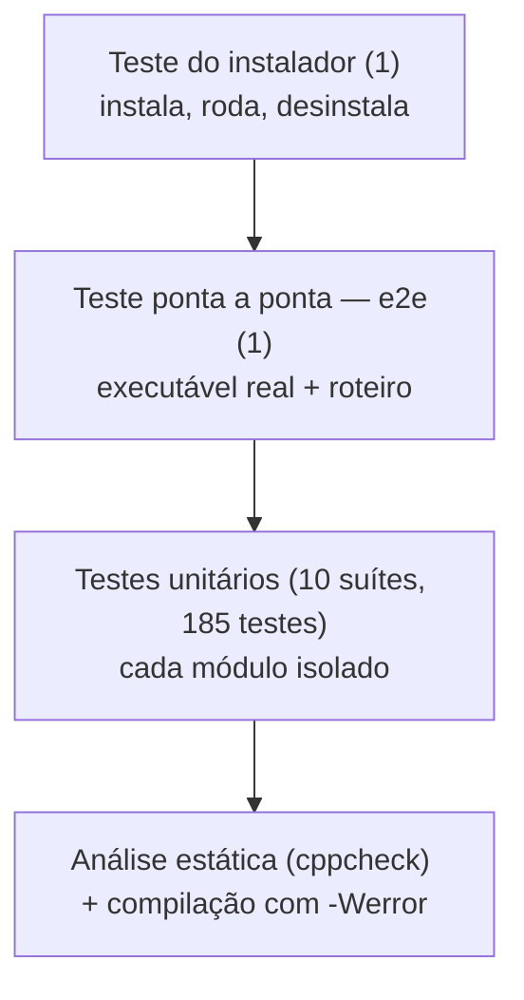
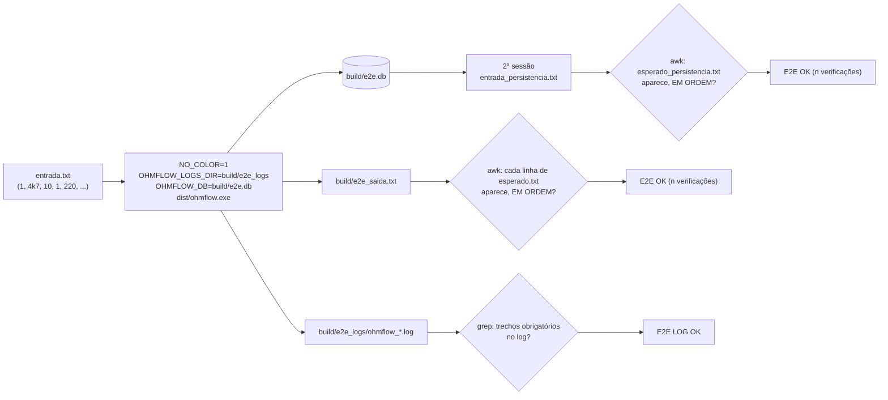

# 06 — Testes

← Anterior: [05 — Build e ambiente](05-build-e-ambiente.md) · [Índice](README.md) · Próximo: [07 — CI e instalador](07-ci-e-instalador.md)

> **Estratégia em uma frase:** cada módulo tem uma suíte de **testes unitários**; o programa inteiro é testado **ponta a ponta** com um roteiro de entradas; e o **instalador** é testado instalando, rodando e desinstalando de verdade. Tudo roda automaticamente no GitHub a cada envio.

---

## 1. Para leigos: o que é testar automaticamente

Em vez de abrir o programa e clicar em tudo a cada mudança, escrevemos **pequenos programas que usam o OhmFlow e conferem os resultados**. Exemplo: "crie uma lista, insira 220 Ω e 100 Ω; a primeira deve ser 100 Ω". Se alguém quebrar a ordenação sem querer, esse teste falha na hora, antes de o erro chegar a quem usa.

## 2. A pirâmide de testes do projeto



**Figura 1 — Camadas de verificação (de cima: mais lentas e amplas; embaixo: rápidas e específicas)**

## 3. O mini framework (`tests/test_framework.h`)

Para não depender de bibliotecas externas, o projeto tem um framework de ~80 linhas:

| Macro / função | Uso |
| --- | --- |
| `ASSERT_TRUE(cond)` | Falha se `cond` for falsa |
| `ASSERT_EQ_INT(esperado, obtido)` | Compara inteiros (como `long long`) |
| `ASSERT_EQ_DBL(esperado, obtido, tol)` | Compara `double` com tolerância relativa |
| `ASSERT_STR_EQ(esperado, obtido)` | Compara textos |
| `RUN_TEST(fn)` | Executa um teste e imprime `[ok]` ou `[FALHOU]` |
| `tf_resumo("suite")` | Imprime o resumo e devolve 1 se algo falhou (o `make test` usa isso) |

Exemplo:

```c
static void teste_insere_inicio_meio_fim(void)
{
    Lista *li = cria_lista();
    ASSERT_EQ_INT(LISTA_OK, insere_lista_ordenada(li, (Resistor){ 1000, 1 }));
    ASSERT_EQ_INT(LISTA_OK, insere_lista_ordenada(li, (Resistor){ 100, 1 }));   /* início */
    ...
    libera_lista(li);
}
int main(void) { RUN_TEST(teste_insere_inicio_meio_fim); return tf_resumo("lista"); }
```

Uma falha mostra arquivo, linha e os valores: `FALHA tests/test_lista.c:42: ... esperado 1, obtido -2`.

## 4. Suítes unitárias

**Tabela 1 — Suítes (contagem na data desta documentação)**

| Suíte | Testes | Cobre |
| --- | --- | --- |
| [test_lista.c](../tests/test_lista.c) | 24 | Inserção ordenada, remoção, consulta, retirar/repor, estouro, invariantes, busca binária (limite de passos), `NULL` |
| [test_pilha.c](../tests/test_pilha.c) | 7 | LIFO, topo, posse dos itens, liberação, percurso |
| [test_checkpoint.c](../tests/test_checkpoint.c) | 12 | Cada inversa, lote em um passo, refazer limpo por ação nova, ir para um ponto |
| [test_formatacao.c](../tests/test_formatacao.c) | 12 | Formatos de entrada, chave canônica, grandezas, arredondamento |
| [test_log.c](../tests/test_log.c) | 16 | Formato das colunas, sessão, falhas de I/O, leitura das últimas ações |
| [test_ui.c](../tests/test_ui.c) | 44 | Largura visível, alinhamento de caixas/tabelas, cores, espera por Enter, centralização, tipo de terminal para a tela cheia |
| [test_telas.c](../tests/test_telas.c) | 35 | Navegação do menu, banner no menu, decodificação de teclas, Histórico, checkpoint pela tela |
| [test_novo.c](../tests/test_novo.c) | 17 | `parse_item`, Novo unitário e em massa, resistor recolorido no lote, ajustes de várias telas |
| [test_resistor.c](../tests/test_resistor.c) | 11 | Código de cores de 4 faixas, nomes das cores, desenho do resistor, linha respondida |
| [test_persistencia.c](../tests/test_persistencia.c) | 7 | Banco novo, ida e volta, foto completa, lista vazia, banco corrompido preservado, argumentos `NULL`, caminho |
| **Total** | **185** | |

### Técnicas usadas

| Técnica | Onde | Para quê |
| --- | --- | --- |
| **Saída para arquivo** (`ui_definir_saida(tmpfile())`) | ui, telas, novo | Ler o que a tela "desenhou" e conferir o texto |
| **Forçar modo** (`ui_definir_interativo`, `ui_definir_cor`) | ui, telas | Testar com e sem cores, com e sem terminal |
| **Entrada simulada** | telas, novo | Alimentar `stdin` com respostas prontas |
| **Funções puras** (`navegar_menu`, `decodifica_tecla` com fonte de bytes falsa) | telas | Testar teclado sem teclado |
| **Pasta e relógio falsos** (`log_definir_pasta`, `log_definir_relogio`) | log | Simular dias diferentes e sessões de horas, sem esperar |
| **Invariantes** | lista | Recontar a lista e comparar com os totais do descritor |

## 5. Teste ponta a ponta (`make e2e`)

Roda o **executável real**, sem terminal, com o teclado substituído por [tests/e2e/entrada.txt](../tests/e2e/entrada.txt) e confere a saída contra [tests/e2e/esperado.txt](../tests/e2e/esperado.txt). Depois roda uma **segunda sessão** no mesmo banco, com [entrada_persistencia.txt](../tests/e2e/entrada_persistencia.txt), e confere com [esperado_persistencia.txt](../tests/e2e/esperado_persistencia.txt) que o estoque voltou.



**Figura 2 — Funcionamento do e2e**

Antes, confere com `objdump` que o exe usa o **subsistema console** (CUI).

**Tabela 2 — O roteiro do e2e**

| Etapa | Entradas | Confere |
| --- | --- | --- |
| Cadastros | `4k7`/10, `220`/50, `470m`/5, `1M`/2 | *"Resistor 4,7 kΩ inserido (10 un.)"* etc. |
| Listar | `3` | Ordem `470 mΩ`, `220 Ω`, `4,7 kΩ`, `1 MΩ`; *"4 tipos · 67 peças"* |
| Duplicado | `1`, `4700` | *"4,7 kΩ já cadastrado"* (nem pergunta a quantidade) |
| Retirar | `4k7` −3 | *"4,7 kΩ: 10 → 7 unidades"* |
| Consultar | `4k7` | *"4,7 kΩ → 7 unidades"* |
| Sem estoque | `4k7` −100 | *"4,7 kΩ tem 7, pedido 100"* |
| Repor | `220` +10 | *"220 Ω: 50 → 60 unidades"* |
| Inválidos | `abc`, `4.7.1`, `xyz` | 3× *"Valor inválido"*, *"Operação cancelada"* |
| Remover | `1M`, `s` | Confirmação e *"1 MΩ removido"* |
| Menu inválido | `x` | *"Opção inválida"* |
| Zerar e repor | `470m` −5, +1 | *"estoque zerado"*, *"0 → 1 unidade"* |
| Reinicializar | `7`, `s` | Aviso, *"Apagar TODOS os 3 tipos (68 peças)?"*, lista vazia |
| Lote | `10k 5`, `22k 3`, `10k 1`, `lixo 2`, `33k`/7 | Resumo 3/1/1; lista com 3 tipos e 15 peças |
| Histórico + checkpoint | `9`, ponto `9` | *"2 ações desfeitas"*, *"Agora no ponto 9 de 11"*, lista volta a 68 peças |
| Refazer | `9`, ponto `11` | *"2 ações refeitas"*, lista com 15 peças |
| Sair | `0` | *"Obrigado por usar o OhmFlow"*, *"Estoque final: 3 tipos · 15 peças"* |
| 2ª sessão | `3`, `0` | Sem cadastrar nada, Listar mostra os 3 tipos e 15 peças salvos no banco |

No log, o e2e exige: cabeçalho da sessão, `NOVO 4,7 kΩ qtd 10 OK`, `RETIRAR ... SEM ESTOQUE`, `NOVO "abc"`, `LOTE CONCLUÍDO`, `DESFAZER`, `REFAZER`, `CHECKPOINT ponto 11 → 9`, `BANCO carga OK`, `BANCO salvamento OK` e o rodapé.

> **Ao mudar uma mensagem de tela**, atualize `esperado.txt` (e os trechos de log no `Makefile`, se for o caso). Linhas vazias em `esperado.txt` são ignoradas; cada linha precisa aparecer como **trecho** de alguma linha da saída, na ordem.

## 6. Teste do instalador (`make teste-setup`)

[tests/setup/test_setup.ps1](../tests/setup/test_setup.ps1) faz, numa pasta temporária e sem tocar nos dados reais:

1. Confere que `dist/ohm_flow_setup.exe` existe.
2. Instala em silêncio (`/VERYSILENT /CURRENTUSER`), sem atalho e sem PATH.
3. Confere `ohmflow.exe`, `README.md`, `LICENSE` e o desinstalador.
4. Roda o exe instalado com o roteiro do e2e, com um `APPDATA` temporário; exige a tela de encerramento e código de saída 0.
5. Confere que o log foi para `%APPDATA%\OhmFlow\logs` e o banco para `%APPDATA%\OhmFlow\ohmflow.db`, e **nenhum dos dois** para a pasta de instalação.
6. Confere a chave de desinstalação no registro (aparece em "Aplicativos instalados").
7. Desinstala e confere que pasta e chave sumiram.

O script é **só ASCII** porque o PowerShell 5.1 lê `.ps1` sem BOM como ANSI.

## 7. Análise estática e sanitizers

| Ferramenta | Comando | O que pega |
| --- | --- | --- |
| `gcc -Wall -Wextra -pedantic -Werror` | `make EXTRA_CFLAGS=-Werror` | Avisos de tipo, variáveis não usadas, C não padrão |
| cppcheck | `make cppcheck` | Possíveis nulos, vazamentos, estilo, desempenho |
| AddressSanitizer + UBSan | `make asan` (fora do Windows) | Acesso fora do limite, uso após `free`, vazamentos, estouro |

Supressões pontuais do cppcheck são feitas no próprio código com `// cppcheck-suppress motivo`.

## 8. Rodando

```powershell
make test                                             # unitários
make e2e                                              # ponta a ponta
make cppcheck                                         # análise estática
make teste-setup                                      # instalador (requer Inno Setup)
make clean; make EXTRA_CFLAGS=-Werror all test e2e cppcheck   # validação completa
```

---

← Anterior: [05 — Build e ambiente](05-build-e-ambiente.md) · [Índice](README.md) · Próximo: [07 — CI e instalador](07-ci-e-instalador.md)
