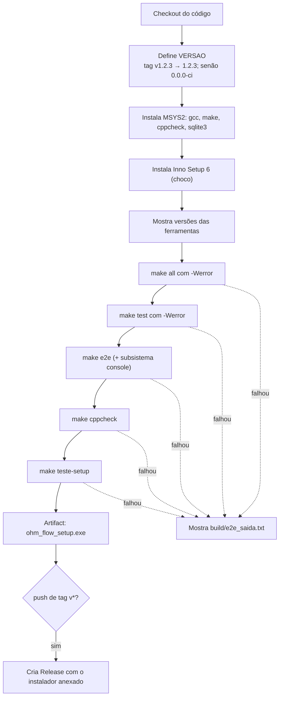

# 07 — CI e instalador

← Anterior: [06 — Testes](06-testes.md) · [Índice](README.md) · Próximo: [08 — Decisões de projeto](08-decisoes-de-projeto.md)

> **Em resumo:** a cada envio de código para o GitHub, um computador Windows na nuvem compila, testa, analisa, gera o instalador e testa o instalador. Se tudo passar, o instalador fica disponível para download; se o envio for uma **tag de versão**, ele é publicado como Release.

---

## 1. Para leigos: o que é CI

**CI** (*Continuous Integration*, integração contínua) é um "robô revisor": toda vez que alguém envia código, ele repete automaticamente todas as verificações que um desenvolvedor cuidadoso faria à mão. Assim, um erro é descoberto em minutos, por quem o causou, e não semanas depois por quem usa o programa.

## 2. O workflow ([.github/workflows/ci.yml](../.github/workflows/ci.yml))

**Quando roda:** push ou pull request para `main` e `Grolla`, e push de tags `v*`.

**Onde roda:** um único job em `windows-latest`, com MSYS2 UCRT64 (o mesmo ambiente do desenvolvimento).



**Figura 1 — Etapas do CI**

| Etapa | Falha quando |
| --- | --- |
| Build `-Werror` | Qualquer aviso do compilador |
| Testes | Qualquer assert falhar |
| e2e | Saída fora do esperado, log incompleto ou exe não for CUI |
| cppcheck | Qualquer problema reportado |
| teste-setup | Instalação, execução, logs ou desinstalação fora do esperado |

A permissão `contents: write` existe só para criar o Release nas tags.

## 3. O instalador ([installer/ohmflow.iss](../installer/ohmflow.iss))

Feito com o **Inno Setup 6**, gratuito e com tradução para português.

**Tabela 1 — Configurações principais**

| Configuração | Valor | Por quê |
| --- | --- | --- |
| `AppId` | GUID fixo | Uma versão nova instala **por cima** da antiga |
| `PrivilegesRequired=lowest` + `PrivilegesRequiredOverridesAllowed=dialog` | Sem admin por padrão; diálogo permite "todos os usuários" | Instalar sem pedir senha de administrador |
| `DefaultDirName={autopf}\OhmFlow` | `%LOCALAPPDATA%\Programs\OhmFlow` ou `Program Files\OhmFlow` | Conforme o modo |
| `MinVersion=10.0`, `x64compatible` | Windows 10+ 64 bits | A UCRT é nativa a partir do 10 |
| `LicenseFile=LICENSE` | Mostra a licença MIT | — |
| Idioma | `BrazilianPortuguese.isl` | — |
| Arquivos | `ohmflow.exe`, `README.md`, `LICENSE` | — |
| Ícones | Menu Iniciar, desinstalador, desktop (opcional) | — |
| Tarefa `path` (opcional) | Código Pascal acrescenta/remove a pasta no PATH (usuário ou máquina) | Rodar `ohmflow` em qualquer terminal; limpo na desinstalação |
| Pós-instalação | Oferece abrir o programa | — |

O `.iss` é salvo em **UTF-8 com BOM** por causa dos acentos.

### O exe do instalador é diferente

`make setup` compila um segundo executável, `dist/instalador/ohmflow.exe`, com `-DOHM_LOGS_APPDATA -DOHM_DADOS_APPDATA`. Ele grava os logs em `%APPDATA%\OhmFlow\logs` e o banco em `%APPDATA%\OhmFlow\ohmflow.db`, porque `Program Files` não aceita escrita sem administrador. O `test_setup.ps1` confere isso.

## 4. Publicar uma versão (Release)

```powershell
git tag v1.0.0
git push origin v1.0.0
```

O CI usa `1.0.0` como `VERSAO` (no instalador e em Propriedades → Detalhes do exe), roda tudo e cria o Release com `ohm_flow_setup.exe` anexado.

Sem tag, todo push gera o instalador como **artifact** (`ohm_flow_setup`), baixável na página da execução do workflow, com versão `0.0.0-ci`.

## 5. Assinatura digital

O instalador **não é assinado** (certificados de assinatura de código são pagos). Por isso o Windows SmartScreen mostra "O Windows protegeu o computador" na primeira execução; basta **Mais informações → Executar assim mesmo**.

---

← Anterior: [06 — Testes](06-testes.md) · [Índice](README.md) · Próximo: [08 — Decisões de projeto](08-decisoes-de-projeto.md)
