# 09 — Contribuindo

← Anterior: [08 — Decisões de projeto](08-decisoes-de-projeto.md) · [Índice](README.md) · Próximo: [10 — Glossário e FAQ](10-glossario-e-faq.md)

> Como trabalhar no código do OhmFlow sem quebrar nada. Complementa o [.github/CONTRIBUTING.md](../.github/CONTRIBUTING.md) e a [.github/COMMIT_CONVENTION.md](../.github/COMMIT_CONVENTION.md).

---

## 1. Fluxo de trabalho

```mermaid
flowchart LR
    A["1. Escrever os testes<br/>da mudança"] --> B["2. Explorar caminhos"]
    B --> C["3. Plano de ação"]
    C --> D["4. Implementar<br/>em tarefas"]
    D --> E["5. Rodar os testes<br/>e corrigir"]
    E --> F["6. Documentar<br/>em CHANGES.md"]
    F --> G["7. Mensagem de commit<br/>a partir do CHANGES.md"]
    G --> H["8. Commit → push → PR<br/>(após validação)"]
    H --> I["9. Limpar CHANGES.md"]
```



**Figura 1 — Fluxo adotado no repositório**

- **Testes primeiro:** a mudança começa pelos testes em `tests/`, que devem falhar antes e passar depois.
- **`CHANGES.md`:** descreve em detalhe o que foi feito; é a base da mensagem de commit e é esvaziado depois do commit.
- **Branches:** o trabalho do dia a dia vai para a branch `Grolla` (ou uma branch de feature) e entra em `main` por pull request. O CI roda em PRs para `main` e `Grolla`.

## 2. Convenções de código

| Regra | Detalhe |
| --- | --- |
| Padrão C | C99 com `-Wall -Wextra -pedantic`; **nenhum aviso** (CI usa `-Werror`) |
| Memória | Todo `malloc` tem o seu `free`; funções `libera_*` aceitam `NULL` |
| Idioma | Nomes, comentários, mensagens e docs em **pt-BR** |
| Estilo | Igual aos arquivos existentes: 4 espaços, chaves de função na linha seguinte, comentários curtos `/* ... */` |
| Camadas | Regra de negócio não imprime; telas não mexem dentro da lista ([04 — Arquitetura](04-arquitetura.md)) |
| Retorno | Funções de estrutura devolvem códigos (`LISTA_*`, `PILHA_*`, `CK_*`) |
| Unicode | Símbolos com alternativa ASCII sob `OHM_ASCII` |
| Fim de linha | LF (garantido pelo `.gitattributes`) |

## 3. Mensagens de commit

Padrão **Conventional Commits** com escopo:

```text
<tipo>(<escopo>): <descrição curta no imperativo>
```

Exemplos reais do histórico: `feat(historico): checkpoint com desfazer/refazer via pilhas`, `chore(assets): move logo e icone para src/assets/logo`. Tipos: `feat`, `fix`, `refactor`, `test`, `docs`, `build`, `ci`, `style`, `chore`, `perf`, `revert`.

## 4. Roteiro: adicionar uma funcionalidade nova

Exemplo concreto: uma opção nova de "resistor mais próximo".

1. **Regra de negócio** — em `lista.h`/`lista.c`, uma função pública nova, por exemplo `vizinhos_lista(const Lista*, double alvo, Resistor *menor, Resistor *maior)`, usando `localiza`. Sem `printf`.
2. **Testes da regra** — em `tests/test_lista.c` (ou suíte nova `tests/test_<nome>.c`): lista vazia, alvo menor que todos, maior que todos, exato, vizinho com quantidade 0.
3. **Suíte nova?** Acrescente o nome em `TESTES` no `Makefile`; se criar um `.c` em `src/`, acrescente-o em `SRC_LIB`.
4. **Tela** — em `telas.c`, crie a `tela_*` nova seguindo o [padrão comum](modulos/telas.md#4-padrão-comum-de-uma-tela): `abre_tela`, dicas, `ler_resistencia`, chamada à lista, `registra(...)` no log, `ui_caixa_feedback`, `voltar_ao_menu`.
5. **Menu** — acrescente a opção ao enum em `telas.h`, o rótulo em `desenha_menu_fase`, a linha na grade de `navegar_menu` e o `case` em `main.c`.
6. **Desfazer** — se a feature **muda o estoque**, registre no checkpoint só no ramo `LISTA_OK` (crie um `OP_*` novo e a inversa em `aplica`, com testes em `test_checkpoint.c`).
7. **e2e** — acrescente o roteiro em `tests/e2e/entrada.txt` e as linhas esperadas em `tests/e2e/esperado.txt`.
8. **Validar** — `make clean; make EXTRA_CFLAGS=-Werror all test e2e cppcheck`.
9. **Documentar** — crie o documento em [funcionalidades/](funcionalidades/README.md) e atualize o módulo de código afetado em [modulos/](modulos/README.md), o `README.md` e o `CHANGES.md`.

## 5. Checklist antes do pull request

- [ ] Testes novos cobrem a mudança e passam.
- [ ] `make clean; make EXTRA_CFLAGS=-Werror all test e2e cppcheck` sem erros.
- [ ] Nenhum vazamento (cada `malloc` com `free`).
- [ ] Mensagens e comentários em pt-BR.
- [ ] Documentação em `docs/` atualizada (funcionalidade e módulo).
- [ ] `CHANGES.md` descreve a mudança.
- [ ] Modelo de PR ([.github/pull_request_template.md](../.github/pull_request_template.md)) preenchido.

## 6. Revisão e responsáveis

O arquivo [CODEOWNERS](../CODEOWNERS) pede revisão dos quatro integrantes para qualquer caminho. Bugs e ideias entram pelos modelos de issue em `.github/ISSUE_TEMPLATE/`: `bug_report.yml` (relato de bug) e `feature_request.yml` (pedido de funcionalidade); `config.yml` desliga issues em branco e aponta para a documentação e a convenção de commits. Problemas de segurança seguem o [.github/SECURITY.md](../.github/SECURITY.md).

## 7. Mantendo esta documentação

- O código é a fonte da verdade; se divergir, corrija a doc no mesmo PR.
- Uma funcionalidade nova ganha um arquivo em `docs/funcionalidades/` (próximo número livre) e uma linha nas tabelas de [funcionalidades/README.md](funcionalidades/README.md) e do [índice](README.md).
- Um arquivo de código novo ganha um documento em `docs/modulos/`.
- Contagens de testes mudam com o tempo; ao alterar suítes, atualize a Tabela 1 de [06 — Testes](06-testes.md).

---

← Anterior: [08 — Decisões de projeto](08-decisoes-de-projeto.md) · [Índice](README.md) · Próximo: [10 — Glossário e FAQ](10-glossario-e-faq.md)
