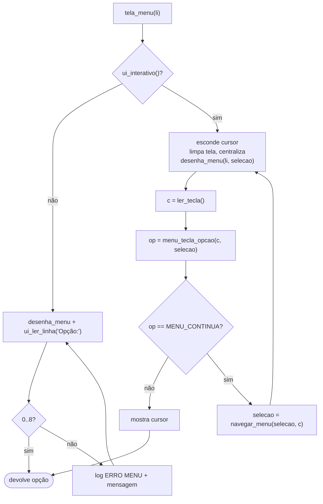

# 00 — Boas-vindas e menu principal

← [Funcionalidades](README.md) · Próximo: [01 — Novo](01-novo.md)

**Código:** `tela_boas_vindas`, `tela_menu`, `desenha_menu`, `navegar_menu`, `menu_tecla_opcao`, `decodifica_tecla`, `ler_tecla` em [src/ui/telas.c](../../src/ui/telas.c)
**Testes:** [tests/test_telas.c](../../tests/test_telas.c), [tests/test_novo.c](../../tests/test_novo.c), e2e

---

## 1. Para que serve

É a porta de entrada e o "painel de controle" do programa. A tela de boas-vindas mostra que o sistema está pronto; o menu dá acesso a todas as funções e mostra, o tempo todo, **quantos tipos** e **quantas peças** há no estoque.

## 2. Como usar

### Boas-vindas

Aparece o logo **OhmFlow** em arte ASCII laranja, o subtítulo "Estoque de Resistores — Estrutura de Dados" e "» Sistema pronto. Pressione Enter para continuar". Pressione **Enter**. Teclas diferentes são ignoradas e não aparecem na tela.

### Menu

```text
╭────────────────────────────────────────────╮
│        Controle de Estoque · 8-Bit         │
├────────────────────────────────────────────┤
│                                            │
│   › [1] Novo         [5] Retirar           │
│     [2] Remover      [6] Repor             │
│     [3] Listar       [7] Reinicializar     │
│     [4] Consultar    [8] Histórico         │
│                                            │
│             Tipos 3 · Peças 20             │
│                                            │
╰────────────────────────────────────────────╯
 ↑↓←→/WASD Navegar · [1-8] Acesso rápido · [Enter] Confirmar · [Esc/0] Sair
```

**Tabela 1 — Teclas**

| Tecla | Efeito |
| --- | --- |
| `↑` `W` | Sobe; da primeira linha vai para a última da mesma coluna |
| `↓` `S` | Desce; da última linha volta à primeira da mesma coluna |
| `←` `A` / `→` `D` | Troca de coluna |
| `1` a `8` | Abre a opção direto |
| `Enter` | Abre a opção selecionada (começa no `[1]`) |
| `Esc` ou `0` | Sai na hora |
| Outras | Ignoradas |

A opção selecionada fica em **laranja e negrito**; as demais, em branco. O banner do OhmFlow fica logo acima do card do menu, e os dois são centralizados na tela como um bloco só. Em terminal estreito (menos de 65 colunas), baixo (menos de 22 linhas) ou com `OHM_ASCII`, o banner sai e o menu volta a ter o título na borda.

## 3. Regras e casos especiais

| Situação | Comportamento |
| --- | --- |
| Janela redimensionada | O menu é redesenhado e recentralizado a cada tecla |
| `Esc` sozinho | Sai em até 0,1 s, sem esperar outra tecla (diferencia `Esc` de uma seta) |
| Alt+tecla, F1, teclas desconhecidas | Ignoradas |
| Terminal fechado / fim da entrada | Tratado como Sair |
| Sem terminal (testes) | O menu pede `Opção:` por linha; `0` sai; texto inválido mostra *"Opção inválida "x". Escolha de 0 a 8."* |
| `Ctrl+C` com o menu aberto | O cursor e o terminal são restaurados antes de o programa encerrar |

## 4. Por dentro



**Figura 1 — Laço do menu**

- Os contadores "Tipos" e "Peças" vêm de `tamanho_lista` e `total_pecas`, que leem o **descritor** da lista em O(1). Por isso o menu pode ser redesenhado a cada tecla sem custo.
- A lógica de teclas (`navegar_menu`, `menu_tecla_opcao`, `decodifica_tecla`) não toca no terminal: recebe números e devolve números. Detalhes em [modulos/telas.md](../modulos/telas.md#6-o-menu-interativo-teclado).

## 5. Registro no log

Só no modo sem terminal, opções inválidas geram:

```text
27/10/2026 14:05:00 | ERRO  | MENU          | "x"        | -                    | OPÇÃO INVÁLIDA
```

## 6. Por que é assim

| Decisão | Motivo |
| --- | --- |
| Navegação por setas **e** por números | Setas são intuitivas; números são rápidos para quem já conhece |
| WASD | Alternativa para teclados sem setas ou para quem prefere |
| Grade 4×2 com `[8] Histórico` | Sair virou tecla (`Esc`/`0`) e não item; sem o placeholder do diferencial, as oito opções fecham a grade |
| Contadores no menu | Visão instantânea do estoque sem abrir o Listar |
| Laranja + branco | Identidade visual "retrô 8-bit" do projeto |

## 7. Testes

- `test_telas.c`: todas as direções e bordas de `navegar_menu`; `decodifica_tecla` com setas, `Esc` isolado, sequência desconhecida e fim da entrada; `Esc` sai; `8` abre o Histórico e `9` não faz nada; cores laranja/branco; Histórico visível como `[8]`; `menu_com_banner` nos limites de largura e altura.
- `test_novo.c`: rótulo "Novo" no menu.
- e2e: o roteiro inteiro passa pelo menu sem terminal, incluindo a opção inválida `x`.

---

← [Funcionalidades](README.md) · Próximo: [01 — Novo](01-novo.md)
