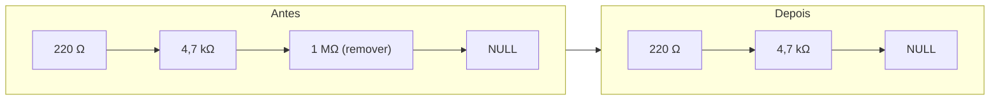

# 02 — Remover (apagar um tipo)

← Anterior: [01 — Novo](01-novo.md) · [Funcionalidades](README.md) · Próximo: [03 — Listar](03-listar.md)

**Menu:** `[2] Remover`
**Código:** `tela_remover`, `ler_cadastrado` em [src/ui/telas.c](../../src/ui/telas.c); `remove_lista` em [src/lista.c](../../src/lista.c)
**Testes:** [tests/test_lista.c](../../tests/test_lista.c), [tests/test_checkpoint.c](../../tests/test_checkpoint.c), e2e

---

## 1. Para que serve

Apagar **completamente** um tipo de resistor do estoque, com toda a sua quantidade. Útil quando um valor deixou de ser usado ou foi cadastrado errado.

> Remover ≠ Retirar. **Retirar** tira algumas peças e mantém o tipo; **Remover** some com o tipo da lista.

## 2. Como usar

1. Digite a resistência: `1M`.
2. O programa confirma: *"⚠ Remover 1 MΩ (2 unidades) do estoque? (s/n):"*.
3. `s` apaga; `n` cancela.

```text
» Resistência: 1M
» ⚠ Remover 1 MΩ (2 unidades) do estoque? (s/n): s
┌─ ✔ SUCESSO ──────────────────────────┐
│ Resistor removido                    │
│ 1 MΩ removido do estoque             │
└──────────────────────────────────────┘
```

## 3. Regras e casos especiais

| Situação | Resultado |
| --- | --- |
| Valor não cadastrado | ✖ *"Resistor não encontrado — 5 kΩ não está no estoque"*; nem pergunta a confirmação |
| Resposta diferente de s/n | *"Responda s (sim) ou n (não)."*; até 3 tentativas, depois conta como **não** |
| `n`, Enter vazio ou EOF na confirmação | *"Operação cancelada"* |
| Valor inválido 3 vezes / Enter vazio na resistência | Cancelada |
| Tipo com quantidade 0 | Pode ser removido normalmente |

Para **corrigir um valor cadastrado errado**, remova e cadastre de novo: a chave de ordenação nunca é alterada no lugar.

## 4. Por dentro

1. `ler_cadastrado` lê a resistência e chama `consulta_lista` para saber se existe e quantas unidades tem (para a pergunta de confirmação).
2. `ui_confirmar` pergunta.
3. `remove_lista` usa `localiza` para obter a **posição** do nó, liga o vizinho (ou o início) ao nó seguinte, fecha a posição no vetor e libera o nó (ver [modulos/lista.md](../modulos/lista.md#52-remover)).
4. Os totais do descritor diminuem: `tipos--`, `pecas -= quantidade`.
5. Com `LISTA_OK`, `ck_registra_remover` guarda o resistor **com a quantidade que tinha**, para poder reinseri-lo igualzinho.



**Figura 1 — Remover o último nó: o penúltimo passa a apontar para NULL**

## 5. Registro no log

```text
| INFO  | REMOVER       | 1 MΩ       | qtd 2                | OK
| AVISO | REMOVER       | 5 kΩ       | -                    | NÃO ENCONTRADO
| AVISO | REMOVER       | 1 MΩ       | -                    | CANCELADO
| ERRO  | REMOVER       | "abc"      | -                    | VALOR INVÁLIDO
```

## 6. Desfazer

Desfazer **reinsere** o tipo com a quantidade que tinha antes; refazer remove de novo. Ver [10 — Desfazer e refazer](10-desfazer-refazer.md).

## 7. Por que é assim

| Decisão | Motivo |
| --- | --- |
| Confirmação obrigatória | Apagar um tipo inteiro é destrutivo; a pergunta mostra quantas unidades serão perdidas |
| Verificar existência antes de perguntar | Não faz sentido confirmar a remoção de algo que não existe |
| Guardar a quantidade no checkpoint | Sem ela, o desfazer recriaria o tipo vazio |

## 8. Testes

- `test_lista.c`: remover primeiro, meio, último e único; inexistente e lista vazia.
- `test_checkpoint.c`: desfazer Remover reinsere com a quantidade.
- e2e: tenta remover `1M`, recebe a confirmação, responde `s`; depois testa a opção inválida `x`.

---

← Anterior: [01 — Novo](01-novo.md) · [Funcionalidades](README.md) · Próximo: [03 — Listar](03-listar.md)
