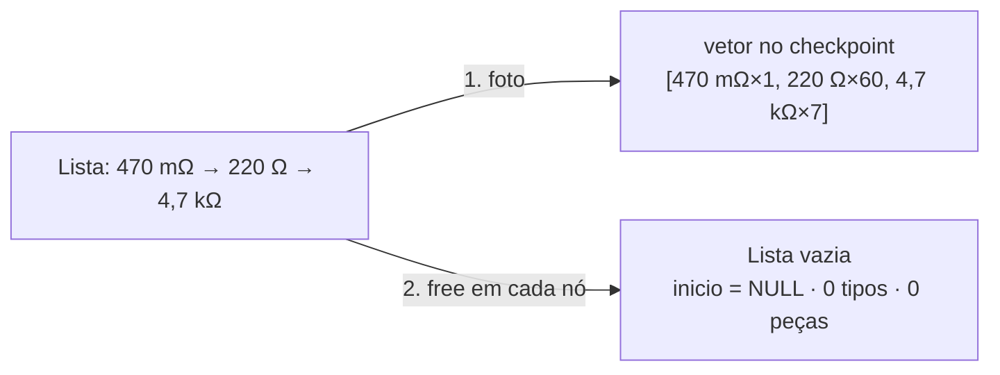

# 07 — Inicializar / Reinicializar (esvaziar o estoque)

← Anterior: [06 — Repor](06-repor.md) · [Funcionalidades](README.md) · Próximo: [09 — Histórico](09-historico.md)

**Menu:** `[7] Reinicializar`
**Código:** `tela_reinicializar` em [src/ui/telas.c](../../src/ui/telas.c); `reinicializa_lista` em [src/lista.c](../../src/lista.c); `ck_registra_reinicializar` em [src/checkpoint.c](../../src/checkpoint.c)
**Testes:** [tests/test_lista.c](../../tests/test_lista.c), [tests/test_novo.c](../../tests/test_novo.c), [tests/test_checkpoint.c](../../tests/test_checkpoint.c), e2e

---

## 1. Para que serve

Deixar a lista **vazia e pronta para uso**, apagando todos os tipos. Corresponde ao requisito "Inicializar/Reinicializar" do enunciado: usado para começar um inventário do zero.

## 2. Como usar

Com resistores cadastrados:

```text
┌─ ⚠ ATENÇÃO ──────────────────────────────────────────────────┐
│ Tem certeza disso, você está apagando sua base de dados.     │
└──────────────────────────────────────────────────────────────┘
» ⚠ Apagar TODOS os 3 tipos (68 peças)? (s/n): s
┌─ ✔ SUCESSO ──────────────────────────┐
│ Estoque reinicializado               │
│ 3 tipos removidos (68 peças)         │
└──────────────────────────────────────┘
```

Com a lista já vazia, não há aviso nem pergunta: *"ℹ Estoque inicializado — Lista vazia e pronta para uso"*.

## 3. Regras e casos especiais

| Situação | Resultado |
| --- | --- |
| Lista com itens + `s` | Tudo apagado |
| `n`, Enter vazio, EOF ou 3 respostas inválidas | *"Operação cancelada"*; nada muda |
| Lista vazia | Apenas confirma; não registra no desfazer |

## 4. Por dentro

1. Lê os totais do descritor para a pergunta.
2. Mostra o aviso amarelo e pede confirmação.
3. **Antes de apagar**, `ck_registra_reinicializar` tira uma **foto** do estoque: aloca um vetor do tamanho exato (`tamanho_lista`) e copia cada resistor com `percorre_lista`.
4. `reinicializa_lista` libera **todos os nós** com `free` (nenhum vazamento), deixa `inicio = NULL` e zera `tipos` e `pecas`. O **descritor continua existindo**: a lista está vazia, não destruída.



**Figura 1 — Foto antes, esvaziamento depois**

## 5. Registro no log

```text
| INFO  | REINICIALIZAR | -          | 3 tipos (68 peças)   | OK
| INFO  | REINICIALIZAR | -          | 0 tipos              | OK
| AVISO | REINICIALIZAR | -          | -                    | CANCELADO
```

## 6. Desfazer

Esta é a ação em que o desfazer mais importa. **Desfazer reinsere todos os itens da foto** (com suas quantidades), e **refazer esvazia de novo**. No e2e, o estoque é reinicializado, um lote novo é cadastrado e depois o Histórico volta ao ponto anterior ao Reinicializar, recuperando os 3 tipos e 68 peças. Ver [10 — Desfazer e refazer](10-desfazer-refazer.md).

## 7. Por que é assim

| Decisão | Motivo |
| --- | --- |
| Aviso em amarelo + confirmação com os números | Ação mais destrutiva do programa; a pessoa vê exatamente o que vai perder |
| Foto do estoque | Única ação que não dá para inverter sem conhecer tudo o que existia |
| Lista vazia não vira checkpoint | Não haveria nada a restaurar; evita ruído na linha do tempo |
| Manter o descritor | "Reinicializar" = esvaziar; destruir a lista é papel do Sair |

## 8. Testes

- `test_lista.c`: `teste_reinicializa`.
- `test_novo.c`: avisa antes; com lista vazia, sem aviso.
- `test_checkpoint.c`: desfazer Reinicializar; lista vazia não registra.
- e2e: aviso, confirmação *"Apagar TODOS os 3 tipos (68 peças)?"*, *"Estoque reinicializado"*, Listar vazio.

---

← Anterior: [06 — Repor](06-repor.md) · [Funcionalidades](README.md) · Próximo: [09 — Histórico](09-historico.md)
