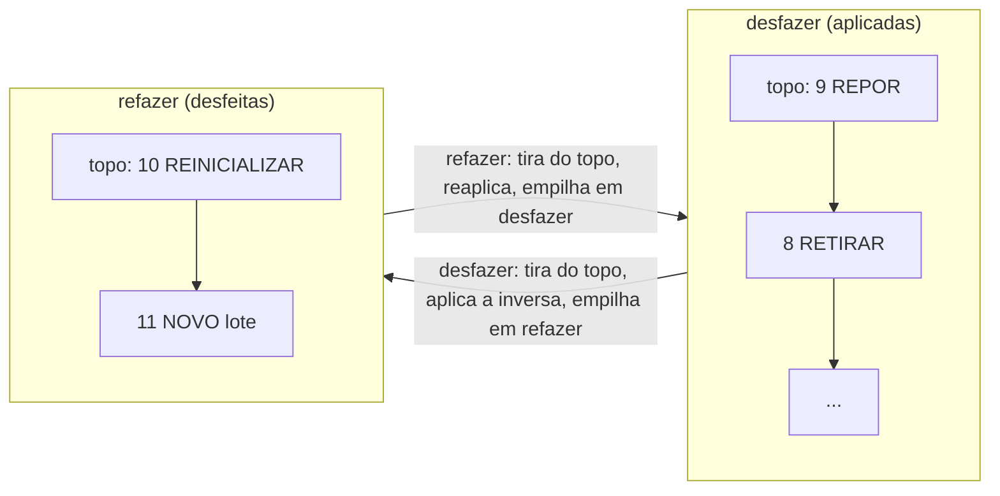

# 10 — Desfazer e refazer (checkpoint da sessão)

← Anterior: [09 — Histórico](09-historico.md) · [Funcionalidades](README.md) · Próximo: [11 — Registro de ações](11-registro-de-acoes.md)

**Onde:** dentro do `[8] Histórico`, tecla `C`
**Código:** `checkpoint_interativo`, `checkpoint_texto`, `desenha_checkpoint`, `linha_checkpoint`, `aplica_checkpoint`, `registra_passo`, `checkpoint_navegar` em [src/ui/telas.c](../../src/ui/telas.c); [src/checkpoint.c](../../src/checkpoint.c); [src/pilha.c](../../src/pilha.c)
**Módulos:** [Checkpoint](../modulos/checkpoint.md) · [Pilha](../modulos/pilha.md)
**Testes:** [tests/test_checkpoint.c](../../tests/test_checkpoint.c), [tests/test_pilha.c](../../tests/test_pilha.c), [tests/test_telas.c](../../tests/test_telas.c), e2e

---

## 1. Para que serve

Voltar o estoque para **qualquer ponto da sessão atual** e, se quiser, avançar de novo. É o "Ctrl+Z / Ctrl+Y" do OhmFlow, só que com uma linha do tempo visível. Salva o dia quando alguém reinicializa ou remove algo sem querer.

## 2. Como usar

1. Menu → `[8] Histórico` → tecla `C`.
2. Aparece a linha do tempo (mais recente em cima):

```text
┌─────┬──────────┬───────────────┬────────────┬────────────┬────────────┐
│ #   │ Hora     │ Ação          │ Resistor   │ Detalhe    │ Estado     │
├─────┼──────────┼───────────────┼────────────┼────────────┼────────────┤
│ 11  │ 14:05:40 │ NOVO          │ 3 tipos    │ lote       │ » atual    │
│ 10  │ 14:05:10 │ REINICIALIZAR │ -          │ 3 tipos    │ aplicada   │
│ 9   │ 14:04:55 │ REPOR         │ 470 mΩ     │ +1         │ aplicada   │
│ ... │          │               │            │            │            │
│ 1   │ 14:03:20 │ NOVO          │ 4,7 kΩ     │ qtd 10     │ aplicada   │
│ 0   │ -        │ INÍCIO        │ -          │ sessão     │ -          │
└─────┴──────────┴───────────────┴────────────┴────────────┴────────────┘
  ↑↓/WS Escolher o ponto · [Enter] Ir para ele · [Esc] Voltar
```

3. `↑`/`W` sobe (mais recente), `↓`/`S` desce (mais antigo). O ponto escolhido fica em laranja.
4. `Enter` leva o estoque até lá. Exemplo: ir para o **9** desfaz o lote e o Reinicializar:

```text
┌─ ✔ SUCESSO ──────────────────────────┐
│ Checkpoint aplicado                  │
│ 2 ações desfeitas                    │
│ Agora no ponto 9 de 11               │
└──────────────────────────────────────┘
```

5. Abrindo de novo, os pontos 10 e 11 aparecem em cinza como **desfeita**; escolher o **11** refaz os dois (*"2 ações refeitas"*).

**Pontos:** `0` = estoque ao abrir o programa (vazio); `N` = estoque logo depois da N-ésima ação.

## 3. O que conta como ação

| Ação | Vira ponto? | Desfazer | Refazer |
| --- | --- | --- | --- |
| [1] Novo (um item) | Sim | Remove o item | Reinsere |
| [1] Novo (lote) | Sim, **um ponto para o lote inteiro** | Remove todos | Reinsere todos |
| [2] Remover | Sim | Reinsere com a quantidade antiga | Remove |
| [5] Retirar *q* | Sim | Repõe *q* | Retira *q* |
| [6] Repor *q* | Sim | Retira *q* | Repõe *q* |
| [7] Reinicializar (lista com itens) | Sim | Reinsere a foto do estoque | Esvazia |
| [7] Reinicializar (lista vazia) | Não | — | — |
| Listar, Consultar, Histórico, cancelamentos, erros | Não | — | — |

## 4. Regras e casos especiais

| Situação | Comportamento |
| --- | --- |
| Escolher o ponto atual | *"Nada a fazer — O estoque já está no ponto N"* |
| Voltar e depois fazer uma ação nova | As ações desfeitas são **descartadas** (não dá mais para refazê-las) |
| Fechar o programa | A linha do tempo é perdida (só vale para a sessão) |
| `Esc`, `0` ou fim da entrada na linha do tempo | Volta sem mudar nada |
| Sem terminal | Pergunta *"Ir para o ponto nº (Enter mantém):"*; número fora de 0..total → *"Ponto inválido"* |
| Falta de memória no meio | *"Falha ao voltar no histórico"*; o estoque fica num ponto válido e o histórico pode ser descartado para não haver inversas erradas |

## 5. Por dentro

O mecanismo usa **duas pilhas** ([modulos/checkpoint.md](../modulos/checkpoint.md)):



**Figura 1 — Estado depois de ir do ponto 11 para o 9**

1. Cada tela registra a ação **depois** de a lista responder `LISTA_OK` (`ck_registra_novo`, `_remover`, `_movimento`, `_reinicializar`). Registrar esvazia a pilha de refazer.
2. `ck_ir_para(alvo)` desfaz enquanto `posição > alvo` e refaz enquanto `posição < alvo`.
3. A cada passo, `registra_passo` grava `DESFAZER`/`REFAZER` no log e conta os passos para a mensagem final.
4. As inversas usam só a API pública da lista (`insere_lista_ordenada`, `remove_lista`, `retira_estoque`, `repor_estoque`, `reinicializa_lista`), então **a ordem e os totais continuam corretos**.

## 6. Registro no log

```text
| INFO  | DESFAZER      | 3 tipos    | NOVO lote            | OK
| INFO  | DESFAZER      | -          | REINICIALIZAR 3 tipos | OK
| INFO  | CHECKPOINT    | -          | ponto 11 → 9         | OK
| INFO  | REFAZER       | -          | REINICIALIZAR 3 tipos | OK
| INFO  | REFAZER       | 3 tipos    | NOVO lote            | OK
| INFO  | CHECKPOINT    | -          | ponto 9 → 11         | OK
| ERRO  | CHECKPOINT    | "abc"      | -                    | PONTO INVÁLIDO
```

## 7. Por que é assim

| Decisão | Motivo |
| --- | --- |
| Pilhas | Estrutura natural para desfazer (LIFO); cada passo em O(1); segunda estrutura de dados para o relatório |
| Guardar a operação, não cópias do estoque | Memória proporcional ao número de ações |
| Linha do tempo com "ir para o ponto" | Mais claro que apertar "desfazer" várias vezes; mostra o que será afetado |
| Só a sessão atual | O banco guarda o estado do estoque, não as operações; o ponto 0 é o estoque carregado ao abrir |
| Não usar o log para desfazer | O log guarda texto já formatado (`4,7 kΩ`), não o `double` exato |
| Descartar o histórico se faltar memória | Nunca aplicar uma inversa sobre um estoque diferente do esperado |

## 8. Testes

- `test_pilha.c`: LIFO, posse dos itens, liberação.
- `test_checkpoint.c`: cada inversa, lote em um passo, ação nova limpa o refazer, ordem cronológica, ir para trás e frente, fora da faixa, `NULL`.
- `test_telas.c`: `checkpoint_navegar`, voltar a um checkpoint pela tela, Enter mantém, sem checkpoint não pergunta.
- e2e: com 11 ações, vai ao ponto 9 (*"2 ações desfeitas"*, estoque volta a 3 tipos e 68 peças), depois ao 11 (*"2 ações refeitas"*); o log precisa conter `DESFAZER`, `REFAZER` e `ponto 11 → 9`.

---

← Anterior: [09 — Histórico](09-historico.md) · [Funcionalidades](README.md) · Próximo: [11 — Registro de ações](11-registro-de-acoes.md)
