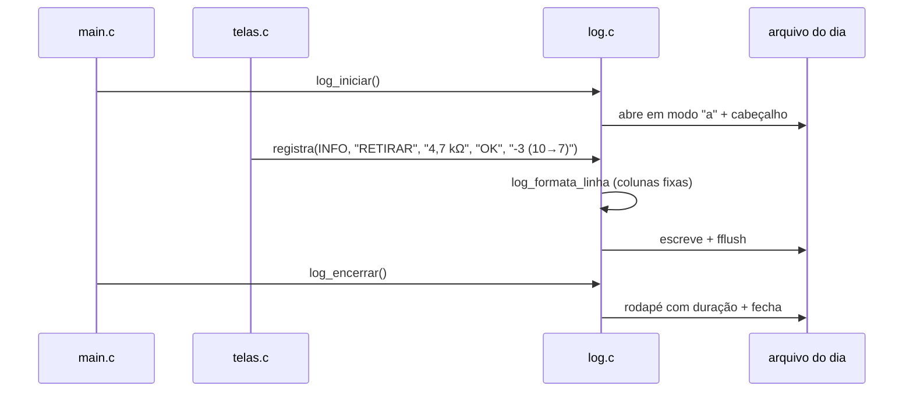

# 11 — Registro de ações (log)

← Anterior: [10 — Desfazer e refazer](10-desfazer-refazer.md) · [Funcionalidades](README.md) · Próximo: [12 — Entrada de valores](12-entrada-de-valores.md)

**Onde:** automático, em todas as telas
**Código:** [src/log.c](../../src/log.c); auxiliares `registra`, `registra_invalido`, `feedback_cancelado` em [src/ui/telas.c](../../src/ui/telas.c); `log_iniciar`/`log_encerrar` em [src/main.c](../../src/main.c)
**Módulo:** [Log](../modulos/log.md)
**Testes:** [tests/test_log.c](../../tests/test_log.c), e2e (confere o arquivo), teste do instalador

---

## 1. Para que serve

Deixar um **rastro permanente** de tudo o que foi feito, mesmo depois de fechar o programa: o que entrou, o que saiu, quem errou a digitação, o que foi cancelado. É a base da tabela do [Histórico](09-historico.md) e permite conferir o estoque físico contra o que o sistema registrou.

## 2. Como usar

Não há nada a fazer: o registro é automático. Para ver:

- Pelo programa: `[8] Histórico` (15 ações mais recentes dos últimos 30 dias).
- Pelo arquivo: abra no Bloco de Notas o `ohmflow_AAAA-MM-DD.log` da pasta da Tabela 1.

**Tabela 1 — Onde ficam os arquivos**

| Situação | Pasta |
| --- | --- |
| Programa instalado | `%APPDATA%\OhmFlow\logs\` |
| Desenvolvimento (`make run`) | `logs\` na pasta atual |
| `OHMFLOW_LOGS_DIR` definida | A pasta indicada |

## 3. O que é registrado

**Tabela 2 — Ações e resultados possíveis**

| Ação | Resultados |
| --- | --- |
| `NOVO` | `OK`, `JÁ CADASTRADO`, `VALOR INVÁLIDO`, `QUANTIDADE INVÁLIDA`, `SEM QUANTIDADE`, `SEM MEMÓRIA`, `CANCELADO`, `LOTE CONCLUÍDO` |
| `REMOVER` | `OK`, `NÃO ENCONTRADO`, `VALOR INVÁLIDO`, `CANCELADO` |
| `LISTAR` | `OK` |
| `CONSULTAR` | `OK`, `NÃO ENCONTRADO`, `VALOR INVÁLIDO`, `CANCELADO` |
| `RETIRAR` | `OK`, `OK - ESTOQUE ZERADO`, `SEM ESTOQUE`, `NÃO ENCONTRADO`, `QUANTIDADE INVÁLIDA`, `VALOR INVÁLIDO`, `CANCELADO` |
| `REPOR` | `OK`, `LIMITE EXCEDIDO`, `NÃO ENCONTRADO`, `QUANTIDADE INVÁLIDA`, `VALOR INVÁLIDO`, `CANCELADO` |
| `REINICIALIZAR` | `OK`, `CANCELADO` |
| `DIFERENCIAL` | `EM BREVE` |
| `HISTÓRICO` | `OK`, `VAZIO` |
| `DESFAZER` / `REFAZER` | `OK` (um por passo) |
| `CHECKPOINT` | `OK`, `FALHOU`, `PONTO INVÁLIDO` |
| `MENU` | `OPÇÃO INVÁLIDA` (só sem terminal) |

**Níveis:** `INFO` = deu certo · `AVISO` = não aconteceu, mas não é erro de entrada (não encontrado, cancelado, sem estoque, estoque zerado) · `ERRO` = entrada inválida ou falha.

Formato completo da linha em [modulos/log.md](../modulos/log.md#2-formato-do-arquivo).

## 4. Regras e casos especiais

| Situação | Comportamento |
| --- | --- |
| Várias execuções no mesmo dia | Cada uma é uma sessão nova **acrescentada** ao mesmo arquivo |
| Virada da meia-noite com o programa aberto | A sessão continua no arquivo do dia em que começou |
| Pasta sem permissão / disco cheio | Aviso único *"Não foi possível abrir o arquivo de log; seguindo sem registro."*; o programa funciona normalmente |
| Janela fechada no X | As linhas já gravadas ficam (cada uma é gravada na hora); só falta o rodapé |
| Texto digitado com `|` | Trocado por `/` para não quebrar as colunas |

## 5. Por dentro

**Figura 1 — Ciclo de uma sessão de log**

## 6. Por que é assim

| Decisão | Motivo |
| --- | --- |
| Arquivo de texto UTF-8 | Qualquer um abre; não precisa do programa |
| Um arquivo por dia | Fácil de achar, arquivar ou apagar |
| Registrar falhas e cancelamentos | Mostra o uso real e onde as pessoas se confundem |
| `fflush` a cada linha | Sobrevive a janela fechada e travamentos |
| Best effort | O controle de estoque é o essencial; o log é um extra |
| `%APPDATA%` no programa instalado | `Program Files` não aceita escrita sem administrador |

## 7. Testes

- `test_log.c`: 16 testes de formato, sessão, falhas de I/O e leitura.
- e2e: confere no arquivo o cabeçalho, linhas `NOVO`, `RETIRAR ... SEM ESTOQUE`, `NOVO "abc"`, `LOTE CONCLUÍDO`, `DESFAZER`, `REFAZER`, `CHECKPOINT ponto 11 → 9` e o rodapé.
- `test_setup.ps1`: o exe instalado grava em `%APPDATA%\OhmFlow\logs` e **não** na pasta de instalação.

---

← Anterior: [10 — Desfazer e refazer](10-desfazer-refazer.md) · [Funcionalidades](README.md) · Próximo: [12 — Entrada de valores](12-entrada-de-valores.md)
