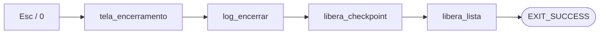

# 13 — Sair (encerramento)

← Anterior: [12 — Entrada de valores](12-entrada-de-valores.md) · [Funcionalidades](README.md) · Próximo: [14 — Resistor colorido](14-resistor-colorido.md)

**Tecla:** `Esc` ou `0` no menu (também: fim da entrada, terminal fechado)
**Código:** `menu_tecla_opcao` e `tela_encerramento` em [src/ui/telas.c](../../src/ui/telas.c); fim de `main` em [src/main.c](../../src/main.c)
**Testes:** [tests/test_telas.c](../../tests/test_telas.c), e2e, teste do instalador

---

## 1. Para que serve

Encerrar o programa **de forma limpa**: mostrar o resumo final, fechar o registro da sessão e devolver ao sistema toda a memória usada, como exige o enunciado ("Sair liberando a memória").

## 2. Como usar

No menu, aperte `Esc` ou `0`. Não há confirmação.

```text
╔══════════════════════════════════════╗
║ Obrigado por usar o OhmFlow!         ║
║ Estoque final: 3 tipos · 15 peças    ║
╚══════════════════════════════════════╝
```

> ⚠️ O estoque **não é salvo**. Ao abrir de novo, a lista começa vazia. O registro em log permanece.

## 3. Por dentro

1. `menu_tecla_opcao` transforma `Esc`/`0`/fim da entrada em `OPCAO_SAIR` (−2, fora da faixa do menu).
2. O laço do `main` termina e chama `tela_encerramento(estoque)`, que lê os totais do descritor.
3. `log_encerrar()` escreve o rodapé com a duração da sessão e fecha o arquivo.
4. `telas_definir_checkpoint(NULL)`, `libera_checkpoint` (esvazia as duas pilhas, liberando cada operação e seus itens) e `libera_lista` (libera cada nó e o descritor).
5. `return EXIT_SUCCESS` (código 0), que os testes conferem.



**Figura 1 — Sequência de encerramento**

## 4. Por que é assim

| Decisão | Motivo |
| --- | --- |
| Sair é tecla, não item do menu | Libera espaço para o `[8] Histórico`; `Esc` é o gesto universal de "sair" |
| Sem confirmação | Sair não apaga nada que pudesse ser salvo; confirmar seria só um passo a mais |
| Liberar tudo explicitamente | Requisito do enunciado e boa prática: cada `malloc` com seu `free` |
| Fim da entrada = sair | Evita laço infinito quando a entrada acaba (testes, terminal fechado) |

## 5. Testes

- `test_telas.c`: `teste_menu_esc_sai`, `teste_tecla_fim_da_entrada`.
- e2e: termina com `0` e confere *"Obrigado por usar o OhmFlow"*, *"Estoque final: 3 tipos · 15 peças"* e o rodapé *"sessão encerrada em"* no log.
- `test_setup.ps1`: o exe instalado chega à tela de encerramento e sai com código 0.

---

← Anterior: [12 — Entrada de valores](12-entrada-de-valores.md) · [Funcionalidades](README.md) · Próximo: [14 — Resistor colorido](14-resistor-colorido.md)
