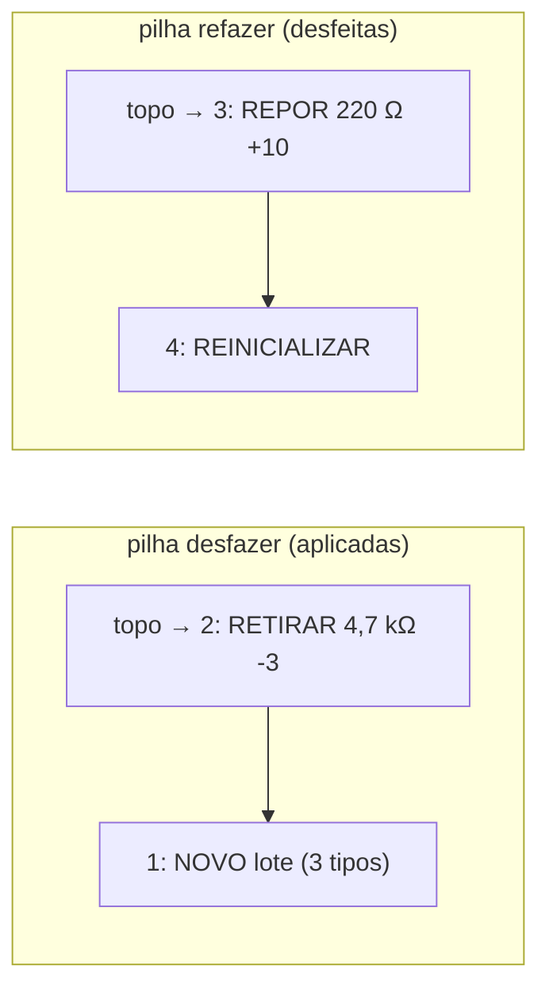
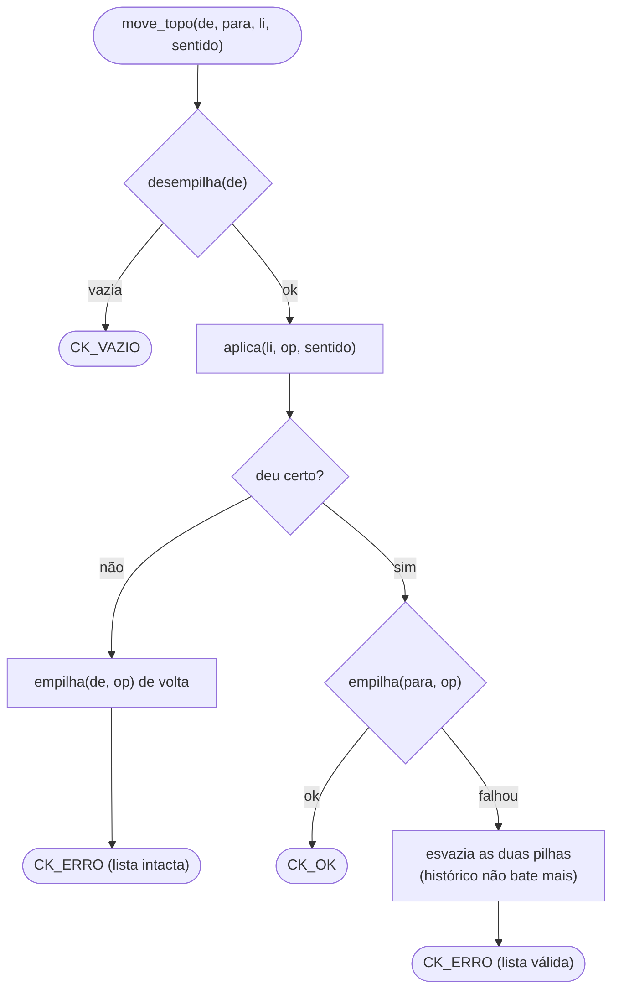

# Módulo Checkpoint — desfazer e refazer com duas pilhas

← Anterior: [Pilha](pilha.md) · [Módulos](README.md) · Próximo: [Log](log.md)

**Arquivos:** [src/checkpoint.h](../../src/checkpoint.h) · [src/checkpoint.c](../../src/checkpoint.c)
**Testes:** [tests/test_checkpoint.c](../../tests/test_checkpoint.c)
**Funcionalidade:** [Desfazer e refazer](../funcionalidades/10-desfazer-refazer.md)

> **Resumo:** mantém a linha do tempo das ações da sessão em **duas pilhas** (desfazer e refazer) e leva o estoque para qualquer ponto dessa linha, aplicando as operações inversas na lista.

---

## 1. Explicação para leigos

É o **Ctrl+Z / Ctrl+Y** do estoque. Imagine duas pilhas de notas: à esquerda, as ações **feitas** (a mais recente em cima); à direita, as ações **desfeitas**. Desfazer pega a nota de cima da esquerda, faz o contrário do que ela diz e a coloca na direita. Refazer faz o caminho de volta. Se você fizer uma ação **nova** depois de desfazer algumas, a pilha da direita vai para o lixo: aquele "futuro" não existe mais.

## 2. Estrutura

```c
struct checkpoint {           /* exposto como "Checkpoint", opaco */
    Pilha *desfazer; /* ações aplicadas (topo = mais recente) */
    Pilha *refazer;  /* ações desfeitas (topo = próxima)      */
};
```

### Posições

A linha do tempo é numerada: **0 é o início da sessão**, e *i* (1..total) é o estado logo depois da *i*-ésima ação, em ordem cronológica.

- **Posição atual** = `tamanho(desfazer)`
- **Total** = `tamanho(desfazer) + tamanho(refazer)`

A Figura 1 mostra uma sessão com 4 ações em que a pessoa voltou para o ponto 2.



**Figura 1 — Posição 2 de 4: duas ações aplicadas, duas desfeitas (a próxima a refazer é a 3)**

## 3. Códigos de retorno

| Código | Valor | Quando |
| --- | --- | --- |
| `CK_OK` | 1 | Sucesso |
| `CK_ERRO` | 0 | Checkpoint/lista `NULL`, falta de memória ou inversa que falhou |
| `CK_VAZIO` | -1 | Nada para desfazer/refazer |
| `CK_INVALIDO` | -2 | Posição fora de 0..total |

## 4. Funções

**Tabela 1 — API do checkpoint**

| Função | Faz |
| --- | --- |
| `cria_checkpoint()` / `libera_checkpoint(c)` | Cria/libera as duas pilhas |
| `ck_registra(c, op)` | Esvazia `refazer`, carimba `op.quando` e empilha em `desfazer` (fica dono de `op.itens`) |
| `ck_registra_novo(c, itens, n)` | Copia os `n` itens e registra `OP_NOVO` (1 item ou o lote inteiro) |
| `ck_registra_remover(c, removido)` | Registra `OP_REMOVER` com o resistor e a quantidade que tinha |
| `ck_registra_movimento(c, tipo, ohms, qtd)` | Registra `OP_RETIRAR` ou `OP_REPOR` |
| `ck_registra_reinicializar(c, li)` | Tira a **foto** da lista **antes** de apagar; lista vazia não registra nada |
| `ck_descarta(c)` | Esvazia as duas pilhas |
| `ck_desfazer(c, li)` / `ck_refazer(c, li)` | Um passo para trás / para frente |
| `ck_ir_para(c, li, alvo, aviso, ctx)` | Desfaz ou refaz até `alvo`, chamando `aviso` a cada passo |
| `ck_posicao(c)`, `ck_total(c)` | Posição atual e total de ações |
| `ck_operacao(c, i)` | A *i*-ésima ação (1..total), aplicada ou desfeita |

## 5. Inversas

A Tabela 2 mostra o que `aplica` faz na lista para cada tipo, nos dois sentidos. Todas usam **só a API pública** da [Lista](lista.md).

**Tabela 2 — Desfazer e refazer de cada operação**

| Operação | Desfazer | Refazer |
| --- | --- | --- |
| `OP_NOVO` (1 ou lote) | `remove_lista` de cada item | `insere_lista_ordenada` de cada item |
| `OP_REMOVER` | reinsere com a quantidade antiga | remove de novo |
| `OP_RETIRAR q` | `repor_estoque(q)` | `retira_estoque(q)` |
| `OP_REPOR q` | `retira_estoque(q)` | `repor_estoque(q)` |
| `OP_REINICIALIZAR` | reinsere todos os itens da foto | `reinicializa_lista` |

**Por que a inversa sempre dá certo:** as pilhas registram **toda** mudança do estoque na sessão. Então, quando a ação do topo é desfeita, a lista está exatamente como ficou logo depois dela. Mesmo assim, cada passo confere o retorno (a única falha realista é falta de memória).

## 6. Algoritmos

### 6.1 Um passo (`move_topo`)



**Figura 2 — Mover uma operação de uma pilha para a outra**

As operações com vários itens (`insere_itens`, `remove_itens`) são **tudo ou nada**: se o 3º item falhar, os 2 primeiros são desfeitos antes de devolver erro.

### 6.2 Ir para um ponto (`ck_ir_para`)

1. Se `alvo` está fora de 0..total → `CK_INVALIDO`.
2. Enquanto `posição > alvo`: desfaz um passo e avisa `CK_DESFEITA`.
3. Enquanto `posição < alvo`: refaz um passo e avisa `CK_REFEITA`.

O `aviso` é como as [Telas](telas.md) registram cada passo no log (`DESFAZER`/`REFAZER`) e contam quantos foram.

### 6.3 Achar a *i*-ésima ação (`ck_operacao`)

| Se | Onde está | Profundidade (0 = topo) |
| --- | --- | --- |
| *i* ≤ posição (aplicada) | pilha `desfazer` | `posição − i` |
| *i* > posição (desfeita) | pilha `refazer` | `i − posição − 1` |

A busca usa `percorre_pilha` com um contador, então é O(n), suficiente para desenhar a linha do tempo.

## 7. A regra de segurança: "nunca uma inversa errada"

Se faltar memória para **registrar** uma ação (ou um item de um lote), o checkpoint chama `ck_descarta` e **apaga todo o histórico**. Parece drástico, mas a alternativa seria pior: com uma ação faltando no meio, desfazer as mais antigas aplicaria inversas sobre um estoque diferente do esperado, corrompendo os dados. Perder o desfazer é aceitável; perder o estoque não.

O mesmo vale em `move_topo` quando a lista já mudou mas a operação não pôde ser empilhada no destino.

## 8. Por que foi feito assim

| Decisão | Motivo | Alternativa descartada |
| --- | --- | --- |
| Duas pilhas | Modelo clássico de desfazer/refazer; cada passo é O(1) | Uma lista com índice (mais código, mesmo resultado) |
| Guardar operações, não cópias do estoque | Memória proporcional às ações, não ao estoque × ações | Foto completa a cada ação |
| Inversas pela API pública | O checkpoint não pode quebrar a ordem nem os totais da lista | Mexer nos nós diretamente |
| Registrar só no ramo `LISTA_OK` | A pilha nunca contém algo que não aconteceu | Registrar antes e corrigir depois |
| Lote de inserção = 1 ação | Para quem usa, foi "um cadastro"; desfazer item a item seria confuso | Uma ação por item |
| Só a sessão atual | O banco guarda o estado do estoque, não as operações; desfazer depois de reabrir exigiria persistir as pilhas | Ler o log (que guarda valores já formatados, não os `double` exatos) |

## 9. Testes

[tests/test_checkpoint.c](../../tests/test_checkpoint.c), 12 testes: checkpoint novo vazio; desfazer/refazer de Novo, do lote em um passo, de Remover, de Retirar e Repor, de Reinicializar; Reinicializar com lista vazia não registra; ação nova limpa o refazer; `ck_operacao` em ordem cronológica; ir para trás e para frente; posição fora da faixa; chamadas com `NULL`.

---

← Anterior: [Pilha](pilha.md) · [Módulos](README.md) · Próximo: [Log](log.md)
