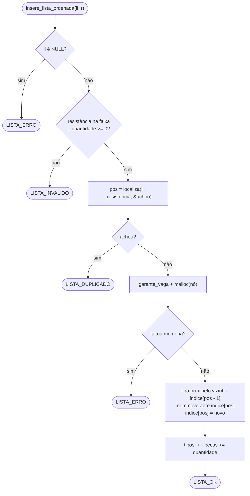
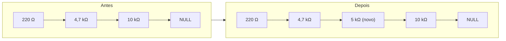
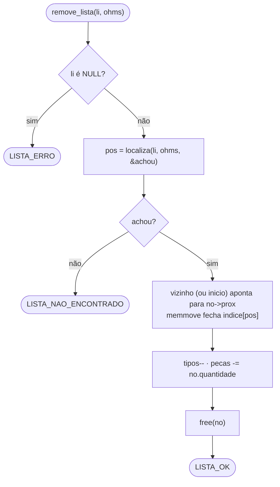
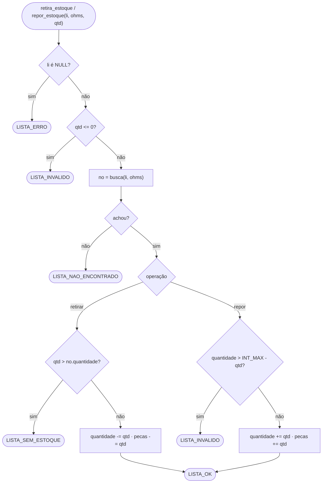

# Módulo Lista — TAD Lista Dinâmica Ordenada

← [Módulos](README.md) · Próximo: [Formatação](formatacao.md)

**Arquivos:** [src/lista.h](../../src/lista.h) (interface) · [src/lista.c](../../src/lista.c) (implementação)
**Testes:** [tests/test_lista.c](../../tests/test_lista.c)

> **Resumo:** guarda os resistores do estoque numa lista simplesmente encadeada, **sempre em ordem crescente de resistência**, com um nó descritor que mantém os totais de tipos e peças e um vetor de ponteiros que permite **busca binária**. É a estrutura central exigida pelo enunciado.

---

## 1. Explicação para leigos

Imagine um **fichário de cartões** onde cada cartão tem um valor de resistor e a quantidade na gaveta. A regra do fichário é: **os cartões ficam sempre em ordem de valor**. Para achar um valor, você abre o fichário **no meio**: se o cartão ali é maior que o procurado, tudo à direita pode ser ignorado; se é menor, tudo à esquerda. Repetindo isso com a metade que sobrou, um fichário de 1.000 cartões se resolve em no máximo 10 olhadas. Quando a metade acaba sem encontrar nada, você parou justamente no lugar onde um cartão novo deve entrar.

Abrir no meio exige saber onde está o meio. Por isso o fichário tem um **índice numerado** com a posição de cada cartão: cartão novo ou retirado obriga a renumerar o índice, mas a procura fica muito mais rápida.

Na frente do fichário fica uma **etiqueta** (o descritor) com "quantos cartões" e "quantas peças no total", atualizada a cada mudança. Assim ninguém precisa recontar tudo para responder a essas perguntas.

## 2. Estruturas

### 2.1 `Resistor` (público)

```c
typedef struct {
    double resistencia; /* valor em Ω (chave de ordenação)   */
    int    quantidade;  /* unidades disponíveis no estoque    */
} Resistor;
```

É a "carga" de cada nó. A resistência é sempre guardada em **ohms**; a conversão para mΩ/kΩ/MΩ só acontece na hora de imprimir ([Formatação](formatacao.md)).

### 2.2 `struct elemento` — o nó (privado)

```c
struct elemento {
    Resistor         dados;
    struct elemento *prox;   /* próximo nó, ou NULL no último */
};
typedef struct elemento Elem;
```

### 2.3 `struct descritor` — a lista (privado, exposto como `Lista`)

```c
struct descritor {
    Elem     *inicio; /* primeiro nó, ou NULL se vazia     */
    Elem    **indice; /* indice[i] = i-ésimo nó em ordem crescente */
    int       capacidade; /* posições alocadas em indice   */
    int       tipos;  /* quantidade de nós                 */
    long long pecas;  /* soma das quantidades              */
    int       passos; /* nós examinados pela última busca  */
};
```

Lista encadeada não tem acesso direto ao meio: chegar ao n-ésimo nó exige passar pelos anteriores. O vetor `indice` resolve isso guardando o endereço de cada nó na ordem da lista, sem copiar os dados. Os nós e o `prox` continuam existindo, e é por eles que `percorre_lista` anda.

No cabeçalho, só aparece `typedef struct descritor Lista;`. Esse é o **tipo opaco**: fora de `lista.c`, ninguém consegue ler `inicio` ou `prox`, apenas usar as funções públicas ([por quê](#7-por-que-foi-feito-assim)).

### 2.4 Constantes

| Constante | Valor | Uso |
| --- | --- | --- |
| `RESISTENCIA_MIN` | `1e-3` (1 mΩ) | Menor resistência aceita |
| `RESISTENCIA_MAX` | `1e9` (1000 MΩ) | Maior resistência aceita |
| `TOLERANCIA_RELATIVA` (privada) | `1e-9` | Margem para comparar dois `double` |
| `CAPACIDADE_INICIAL` (privada) | `8` | Primeira alocação do vetor `indice`, que depois dobra |

### 2.5 Códigos de retorno

| Código | Valor | Quando |
| --- | --- | --- |
| `LISTA_OK` | 1 | Sucesso |
| `LISTA_ERRO` | 0 | Lista `NULL` ou falta de memória |
| `LISTA_NAO_ENCONTRADO` | -1 | Resistência não cadastrada |
| `LISTA_DUPLICADO` | -2 | Resistência já cadastrada |
| `LISTA_SEM_ESTOQUE` | -3 | Retirada maior que o disponível |
| `LISTA_INVALIDO` | -4 | Resistência fora da faixa, quantidade ≤ 0 em movimentos, negativa no cadastro, ou soma que estouraria o `int` |

## 3. O coração: `localiza`

Todas as buscas passam por uma única função interna, uma **busca binária** sobre o vetor `indice`:

```c
static int localiza(Lista *li, double ohms, int *achou)
{
    int ini = 0, fim = li->tipos - 1;
    li->passos = 0;
    *achou = 0;
    while (ini <= fim) {
        int meio = ini + (fim - ini) / 2;
        double valor = li->indice[meio]->dados.resistencia;
        li->passos++;
        if (mesma_resistencia(valor, ohms)) {
            *achou = 1;
            return meio;
        }
        if (valor < ohms) ini = meio + 1; /* direita: resistências maiores  */
        else              fim = meio - 1; /* esquerda: resistências menores */
    }
    return ini;
}
```

Em português: "olhe o termo do meio do trecho ainda possível. Se for o procurado, terminou. Se for menor, o procurado só pode estar à direita; se for maior, só pode estar à esquerda. Repita com a metade restante."

Quando o trecho fica vazio, o valor não existe e `ini` é exatamente **a posição onde ele deveria entrar**. Por isso a mesma função serve para buscar e para escolher o lugar da inserção.

`ini + (fim - ini) / 2` é escrito assim, e não `(ini + fim) / 2`, para a soma nunca estourar o `int`.

A Tabela 1 mostra o caminho de `localiza` na lista `100 Ω → 220 Ω → 1 kΩ → 4,7 kΩ → 10 kΩ → 47 kΩ → 1 MΩ`. O número de passos fica em `lista_passos(li)`.

**Tabela 1 — Passos da busca binária (7 tipos: no máximo 3 passos)**

| Procurando | Termos olhados | Passos | Resultado |
| --- | --- | --- | --- |
| 4,7 kΩ | 4,7 kΩ | 1 | achou no meio |
| 220 Ω | 4,7 kΩ, 220 Ω | 2 | achou à esquerda |
| 1 MΩ | 4,7 kΩ, 47 kΩ, 1 MΩ | 3 | achou à direita |
| 5 kΩ | 4,7 kΩ, 47 kΩ, 10 kΩ | 3 | não existe; entraria na posição 4 |

Toda busca termina em no máximo ⌈log₂(n + 1)⌉ passos: 1.023 tipos cabem em 10, o que `teste_busca_passos_logaritmicos` confere.

Funções auxiliares privadas:

| Função | O que faz |
| --- | --- |
| `busca(li, ohms)` | `localiza` + leitura de `indice`: devolve o nó ou `NULL` |
| `garante_vaga(li)` | Dobra a capacidade de `indice` quando ele está cheio |
| `resistencia_valida(ohms)` | Não é `NaN` e está entre 1 mΩ e 1000 MΩ (com a tolerância) |
| `libera_nos(li)` | Dá `free` em todos os nós e zera os totais |

## 4. Funções públicas

**Tabela 2 — API da lista**

| Função | Recebe | Faz | Devolve | Custo |
| --- | --- | --- | --- | --- |
| `cria_lista()` | — | Aloca o descritor vazio | `Lista*` ou `NULL` | O(1) |
| `libera_lista(li)` | lista (pode ser `NULL`) | Libera todos os nós, o vetor e o descritor | — | O(n) |
| `reinicializa_lista(li)` | lista | Libera os nós, mantém o descritor e o vetor | `LISTA_OK`/`ERRO` | O(n) |
| `tamanho_lista(li)` | lista | Lê `tipos` | número de tipos (0 se `NULL`) | O(1) |
| `total_pecas(li)` | lista | Lê `pecas` | soma das quantidades | O(1) |
| `lista_vazia(li)` | lista | `inicio == NULL` | 1/0 | O(1) |
| `insere_lista_ordenada(li, r)` | lista, resistor | Encaixa na posição certa | `OK`, `DUPLICADO`, `INVALIDO`, `ERRO` | O(log n) para achar + O(n) para deslocar o vetor |
| `remove_lista(li, ohms)` | lista, valor | Tira o nó e libera | `OK`, `NAO_ENCONTRADO`, `ERRO` | O(log n) para achar + O(n) para deslocar o vetor |
| `consulta_lista(li, ohms, &qtd)` | lista, valor, onde gravar | Lê a quantidade (`qtd` pode ser `NULL`) | `OK`, `NAO_ENCONTRADO`, `ERRO` | O(log n) |
| `retira_estoque(li, ohms, qtd)` | lista, valor, qtd > 0 | Subtrai | `OK`, `SEM_ESTOQUE`, `NAO_ENCONTRADO`, `INVALIDO`, `ERRO` | O(log n) |
| `repor_estoque(li, ohms, qtd)` | lista, valor, qtd > 0 | Soma (sem estourar `INT_MAX`) | `OK`, `NAO_ENCONTRADO`, `INVALIDO`, `ERRO` | O(log n) |
| `percorre_lista(li, f, ctx)` | lista, função, contexto | Chama `f(&resistor, ctx)` para cada nó, em ordem | — | O(n) |
| `lista_passos(li)` | lista | Lê `passos` | nós examinados na última busca | O(1) |
| `mesma_resistencia(a, b)` | dois valores | Compara com tolerância relativa 1e-9 | 1/0 | O(1) |

Todas as funções aceitam `li == NULL` sem travar (devolvem `LISTA_ERRO`, 0 ou não fazem nada). Isso é testado em `teste_lista_nula`.

## 5. Algoritmos passo a passo

### 5.1 Inserir

A Figura 1 mostra o fluxo de `insere_lista_ordenada`.



**Figura 1 — Fluxo da inserção ordenada**

Exemplo: inserir **5 kΩ** em `220 Ω → 4,7 kΩ → 10 kΩ`. `localiza` devolve a posição 2, a do 10 kΩ. O vizinho da esquerda, `indice[1]`, é o 4,7 kΩ: o novo nó aponta para o 10 kΩ, e o `prox` do 4,7 kΩ passa a apontar para o novo, como na Figura 2. Depois, `memmove` empurra o 10 kΩ uma casa à direita no vetor e o novo ocupa a posição 2.



**Figura 2 — Inserção no meio: na corrente de nós, só dois ponteiros mudam**

**Tabela 3 — Casos de borda da inserção**

| Caso | O que acontece |
| --- | --- |
| Lista vazia | `pos` é 0 e não há vizinho: `inicio` aponta para o novo |
| Menor que todos | `pos` é 0: o novo aponta para o antigo primeiro e vira `inicio` |
| Maior que todos | `pos` é `tipos`: `memmove` não desloca nada e o novo vira o último |
| Já cadastrada (inclusive `470m` × `0.47`) | `LISTA_DUPLICADO`, nada muda |
| Fora de 1 mΩ..1000 MΩ, `NaN` ou quantidade negativa | `LISTA_INVALIDO` |
| Quantidade zero | Permitida: o tipo existe, sem peças |
| Vetor cheio | `garante_vaga` dobra a capacidade antes de criar o nó; se faltar memória, a lista fica intacta |

### 5.2 Remover



**Figura 3 — Fluxo da remoção**

Ao remover 4,7 kΩ de `220 Ω → 4,7 kΩ → 10 kΩ`, o `prox` do 220 Ω passa a apontar direto para o 10 kΩ, e o nó do meio é liberado. Remover o primeiro troca `li->inicio`; remover o último faz o penúltimo apontar para `NULL`. Nos três casos, `memmove` fecha a posição no vetor.

### 5.3 Retirar, repor e consultar

As três usam `busca` (ou seja, `localiza`) para achar o nó e **só mexem no campo `quantidade`** e no total `pecas`. A forma da lista e a ordem nunca mudam.



**Figura 4 — Fluxo de retirar e repor**

Detalhes:

- **Retirar até zero é permitido.** O tipo continua cadastrado com quantidade 0; para apagá-lo, use `remove_lista`.
- **O teste de estouro** (`quantidade > INT_MAX - qtd`) é escrito assim de propósito: calcular `quantidade + qtd` primeiro poderia estourar antes da comparação, o que em C é comportamento indefinido.
- **Não existe "editar resistência".** A chave nunca é alterada no lugar, porque isso poderia quebrar a ordem. Para corrigir um valor, remove-se e insere-se de novo.

### 5.4 Percorrer

`percorre_lista(li, f, ctx)` visita os nós do início ao fim e chama `f` para cada um. É um **callback**: quem chama passa "o que fazer com cada resistor", e o `ctx` carrega dados extras (por exemplo, o contador de linhas da tabela). Assim, `telas.c` desenha a tabela e `checkpoint.c` tira a "foto" do estoque **sem conhecer os nós**.

## 6. Invariantes (o que é sempre verdade)

Depois de qualquer operação pública:

1. Os nós estão em **ordem estritamente crescente** de resistência (nunca dois iguais).
2. `tipos` é igual ao número de nós, e `indice[i]` é o i-ésimo nó da corrente.
3. `pecas` é igual à soma das quantidades.
4. Toda quantidade é ≥ 0.
5. Toda resistência está entre 1 mΩ e 1000 MΩ.

O teste `teste_contadores_invariantes` faz dezenas de operações e confere 2 e 3 recontando a lista com `percorre_lista`.

## 7. Por que foi feito assim

| Decisão | Motivo | Alternativa descartada |
| --- | --- | --- |
| Lista encadeada **com** vetor de ponteiros | Mantém a lista dinâmica do enunciado e dá acesso direto ao meio | Vetor puro de `Resistor` (deixa de ser lista); busca binária andando pelos nós (mesmas comparações, mas O(n) passos até cada meio) |
| **Nó descritor** | Totais em O(1) para o menu, que é redesenhado o tempo todo | Recontar a lista a cada desenho do menu |
| **Tipo opaco** | Ninguém fora de `lista.c` consegue quebrar a ordem ou os totais | Struct pública (mais simples, mas frágil) |
| Vetor guarda ponteiros, não cópias | Deslocar é trocar endereços; o dado fica só no nó | Duplicar os resistores no vetor |
| Uma função de busca para tudo | A regra de comparação fica em um lugar só | Laços de busca repetidos em cada operação |
| `double` em Ω | Cobre de 0,001 a 1.000.000.000 com casas decimais | Inteiro em mΩ (1000 MΩ = 10¹² mΩ não cabe em `int`) |
| **Comparação com tolerância** | Rede de segurança contra arredondamento binário | `==` direto entre `double` |
| `long long` em `pecas` | No Windows `long` tem 32 bits; muitos tipos com quantidade alta estourariam | `long` |
| Códigos de retorno em vez de mensagens | A lista não sabe nada de tela; quem chama decide o texto | `printf` dentro da lista |
| `passos` no descritor | Comprova o custo logarítmico nos testes e no relatório | Não medir |

## 8. Testes

[tests/test_lista.c](../../tests/test_lista.c) tem 24 testes, entre eles: lista nova vazia; inserção no início, meio e fim; duplicados; valores inválidos; remoção do primeiro, do meio, do último e do único; consulta; retirada parcial, total e além do estoque; reposição e estouro de `INT_MAX`; total de peças sem estouro; reinicialização; invariantes; contagem de passos da busca binária, limite logarítmico com 1.023 tipos; ordem após inserções crescentes, decrescentes e embaralhadas; remoção mantendo a busca; chamadas com `NULL`; e `mesma_resistencia`.

---

← [Módulos](README.md) · Próximo: [Formatação](formatacao.md)
