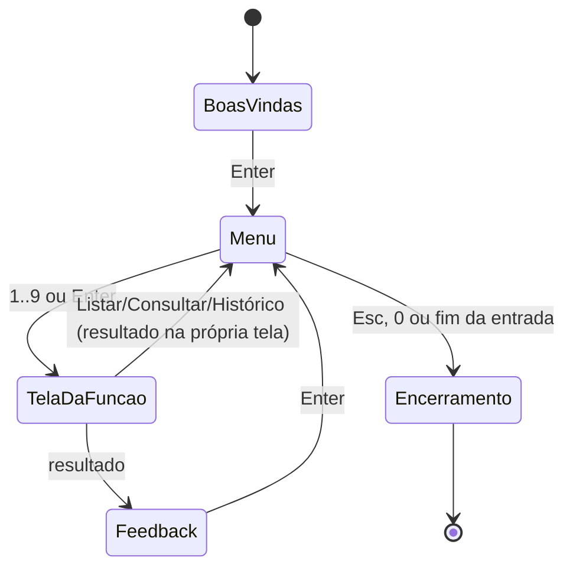

# Módulo Telas — roteiro de navegação e cada tela

← Anterior: [UI](ui.md) · [Módulos](README.md) · Próximo: [Main](main.md)

**Arquivos:** [src/ui/telas.h](../../src/ui/telas.h) · [src/ui/telas.c](../../src/ui/telas.c)
**Testes:** [tests/test_telas.c](../../tests/test_telas.c) · [tests/test_novo.c](../../tests/test_novo.c)

> **Resumo:** implementa cada tela do programa (boas-vindas, menu, as funções 1 a 8 e o encerramento). Cada tela pergunta, valida, chama a regra de negócio ([Lista](lista.md), [Checkpoint](checkpoint.md)), registra no [Log](log.md) e mostra o resultado com as peças da [UI](ui.md).

> O comportamento **de cada funcionalidade**, do ponto de vista do usuário até o código, está detalhado em [docs/funcionalidades/](../funcionalidades/README.md). Este documento cobre o que é comum a todas as telas.

---

## 1. Explicação para leigos

É o **atendente do balcão**. Ele faz as perguntas, confere se as respostas fazem sentido, pede para o estoquista (a lista) fazer o serviço, anota no livro de ocorrências (o log) e diz ao cliente como foi. Ele mesmo não mexe nas prateleiras.

## 2. Roteiro de navegação



**Figura 1 — Máquina de estados das telas**

## 3. Opções do menu

```c
enum { OPCAO_INSERIR = 1, OPCAO_REMOVER, OPCAO_LISTAR, OPCAO_CONSULTAR,
       OPCAO_RETIRAR, OPCAO_REPOR, OPCAO_REINICIALIZAR,
       OPCAO_HISTORICO, OPCAO_TOTAL };
#define OPCAO_SAIR (-2)   /* não é item do menu */
```

**Tabela 1 — Opção → tela → funcionalidade**

| Opção | Função de tela | Documento |
| --- | --- | --- |
| — | `tela_boas_vindas`, `tela_menu` | [Boas-vindas e menu](../funcionalidades/00-boas-vindas-e-menu.md) |
| 1 | `tela_inserir` | [Novo](../funcionalidades/01-novo.md) |
| 2 | `tela_remover` | [Remover](../funcionalidades/02-remover.md) |
| 3 | `tela_listar` | [Listar](../funcionalidades/03-listar.md) |
| 4 | `tela_consultar` | [Consultar](../funcionalidades/04-consultar.md) |
| 5 | `tela_retirar` | [Retirar](../funcionalidades/05-retirar.md) |
| 6 | `tela_repor` | [Repor](../funcionalidades/06-repor.md) |
| 7 | `tela_reinicializar` | [Reinicializar](../funcionalidades/07-reinicializar.md) |
| 9 | `tela_historico` | [Histórico](../funcionalidades/09-historico.md) e [Desfazer/refazer](../funcionalidades/10-desfazer-refazer.md) |
| Esc/0 | `tela_encerramento` | [Sair](../funcionalidades/13-sair.md) |
| dentro do 1 | `abre_tela_novo`, `colore_resistor`, `mostra_resistor` | [Resistor colorido](../funcionalidades/14-resistor-colorido.md) |

## 4. Padrão comum de uma tela

Todas as telas que mudam o estoque seguem o mesmo esqueleto:

1. `abre_tela(titulo, altura)` — limpa, centraliza na vertical e desenha o título numa caixa arredondada. (A tela Novo usa `abre_tela_novo`, que põe o desenho do resistor dentro dessa caixa.)
2. Dicas (`ui_dica`): formatos aceitos, "Enter vazio cancela".
3. Perguntas com os auxiliares de leitura (seção 5).
4. Chamada à lista e análise do código de retorno.
5. **Só no `LISTA_OK`:** registro no checkpoint (`ck_registra_*`).
6. **Sempre:** linha no log com `registra(...)`.
7. Caixa de feedback (`ui_caixa_feedback`) e `voltar_ao_menu()` ("Pressione Enter para voltar ao menu...").

## 5. Auxiliares de leitura e validação

| Auxiliar | Faz |
| --- | --- |
| `ler_resistencia(acao, &ohms)` | Pergunta "Resistência:", usa `parse_resistencia`; até **3 tentativas**; Enter vazio ou EOF cancela; cada inválido vira `ERRO ... VALOR INVÁLIDO` no log |
| `parse_quantidade(s, minimo, &qtd)` | Inteiro de `minimo` a `INT_MAX` via `strtoll` (recusa sinal estranho, texto sobrando, estouro) |
| `ler_quantidade(acao, alvo, prompt, minimo, &qtd)` | Igual a `ler_resistencia`, para quantidades; inválidos viram `QUANTIDADE INVÁLIDA` |
| `ler_cadastrado(acao, li, ...)` | Lê a resistência e **exige que esteja cadastrada**; senão mostra "Resistor não encontrado" e registra `NÃO ENCONTRADO` |
| `parse_item(s, &r)` | Linha da tela Novo: `"4k7 50"` → `ITEM_COMPLETO`; `"4k7"` → `ITEM_SO_RESISTENCIA`; o resto → `ITEM_INVALIDO` |
| `feedback_cancelado(acao, alvo)` | Registra `AVISO ... CANCELADO` e mostra "Operação cancelada" |

Mínimo de quantidade: **0** em Novo (pode cadastrar sem peças) e **1** em Retirar/Repor.

## 6. O menu interativo (teclado)

### 6.1 Ler uma tecla (`ler_tecla`, `decodifica_tecla`)

Setas não são um caractere só: no Windows, `_getch` devolve `0` ou `224` seguido de um código (72 ↑, 80 ↓, 75 ←, 77 →); em terminais POSIX, chegam como `ESC [ A`. O programa traduz tudo para constantes próprias (`KEY_UP`, `KEY_DOWN`, `KEY_LEFT`, `KEY_RIGHT`, `KEY_ESC`, `KEY_FIM`, `KEY_IGNORADA`).

Problema clássico: `Esc` sozinho também é o byte `ESC`. Como saber se vem uma seta depois? `decodifica_tecla` lê os bytes seguintes **com prazo curto** (0,1 s); se nada chegar, é `Esc` sozinho. Isso impede que apertar `Esc` trave o menu esperando outra tecla.

### 6.2 Navegar (`navegar_menu`)

O menu é uma grade de 2 colunas × 4 linhas (1–4 à esquerda, 5–8 à direita) mais uma linha inferior com o 9.

| Tecla | Efeito |
| --- | --- |
| ↑ / W | Linha de cima; da primeira linha vai para o Histórico; do Histórico vai para a 4ª linha |
| ↓ / S | Linha de baixo; da 4ª linha vai para o Histórico; do Histórico volta para a 1ª linha |
| ← / A, → / D | Troca de coluna (no Histórico não faz nada) |

`navegar_menu` e `menu_tecla_opcao` são **funções puras** (só recebem números e devolvem números), por isso são testadas sem terminal.

### 6.3 Escolher (`menu_tecla_opcao`)

| Tecla | Resultado |
| --- | --- |
| `Esc`, `0`, fim da entrada | `OPCAO_SAIR` |
| `1`..`9` | Abre a opção direto |
| `Enter` | Abre a opção selecionada |
| Outras | `MENU_CONTINUA` (só navega ou ignora) |

### 6.4 Menu sem terminal

Sem terminal, o menu é desenhado e lê uma linha `Opção:`. `0` sai, `1`..`9` abre, o resto mostra "Opção inválida" e registra `ERRO MENU "texto" OPÇÃO INVÁLIDA`.

### 6.5 Proteção do terminal

Durante o menu o cursor fica escondido e, fora do Windows, o terminal fica em modo "cru". Se o programa for interrompido (`Ctrl+C`, `SIGTERM`...), `restaura_terminal_e_sai` devolve o terminal e o cursor ao normal antes de encerrar. Sem isso, o terminal da pessoa ficaria sem cursor depois do programa.

## 7. Estado do módulo

Duas variáveis globais do módulo:

| Variável | Definida por | Efeito |
| --- | --- | --- |
| `static Checkpoint *checkpoint` | `telas_definir_checkpoint(ck)` | `NULL` (como nos testes que não precisam do histórico) faz as funções `ck_*` não registrarem nada |
| `static int modo_resistor` | `telas_definir_resistor(modo)` | Desenho do resistor na tela Novo: −1 automático (só terminal com cores), 0 nunca, 1 sempre (testes); sem efeito com `-DOHM_ASCII` |

## 8. Por que foi feito assim

| Decisão | Motivo |
| --- | --- |
| Lógica de teclado em funções puras | Testável sem terminal real |
| 3 tentativas por pergunta | Equilíbrio entre tolerar erro de digitação e não prender a pessoa em loop |
| Enter vazio cancela em qualquer pergunta | Uma saída sempre óbvia, igual em todas as telas |
| Consultar antes de alterar | Mensagens específicas ("já cadastrado - use [6] Repor", "Em estoque: 10") |
| Registrar no log também falhas | Rastreabilidade completa |
| Checkpoint injetado | `telas.c` não cria estado escondido; `main` controla o ciclo de vida |
| Alturas estimadas por tela | Centralização vertical sem medir a saída |

## 9. Testes

- [tests/test_telas.c](../../tests/test_telas.c), 28 testes: navegação em todas as direções e bordas, decodificação de teclas (setas, Esc isolado, sequência desconhecida, fim da entrada), Esc sai, 9 abre o Histórico, cores do menu, tela de Histórico com ações, `checkpoint_navegar`, voltar a um checkpoint, Enter mantém, sem checkpoint não pergunta.
- [tests/test_novo.c](../../tests/test_novo.c), 17 testes: `parse_item` (completo, só resistência, inválido, limite de `int`), Novo unitário e duplicado, em massa, EOF encerra o lote, primeira linha inválida tenta de novo, lote recolore o resistor, sem terminal não há resistor, rótulo do menu, Listar vazio, Consultar sem passos, avisos do Reinicializar e valores da tabela sem cor.

---

← Anterior: [UI](ui.md) · [Módulos](README.md) · Próximo: [Main](main.md)
